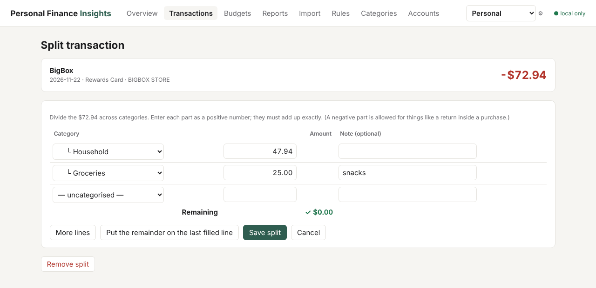
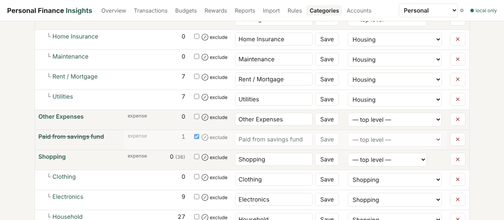
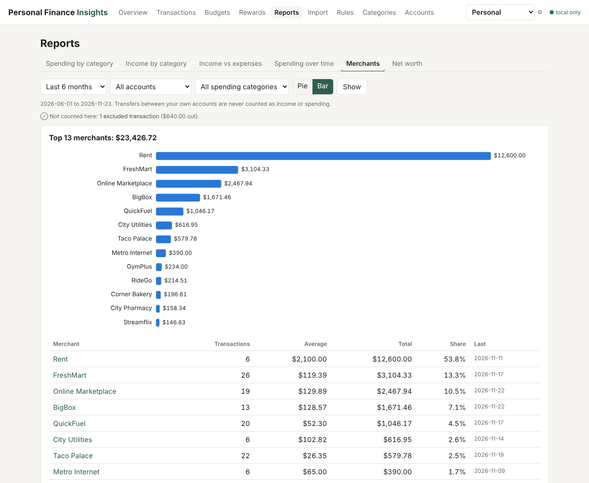
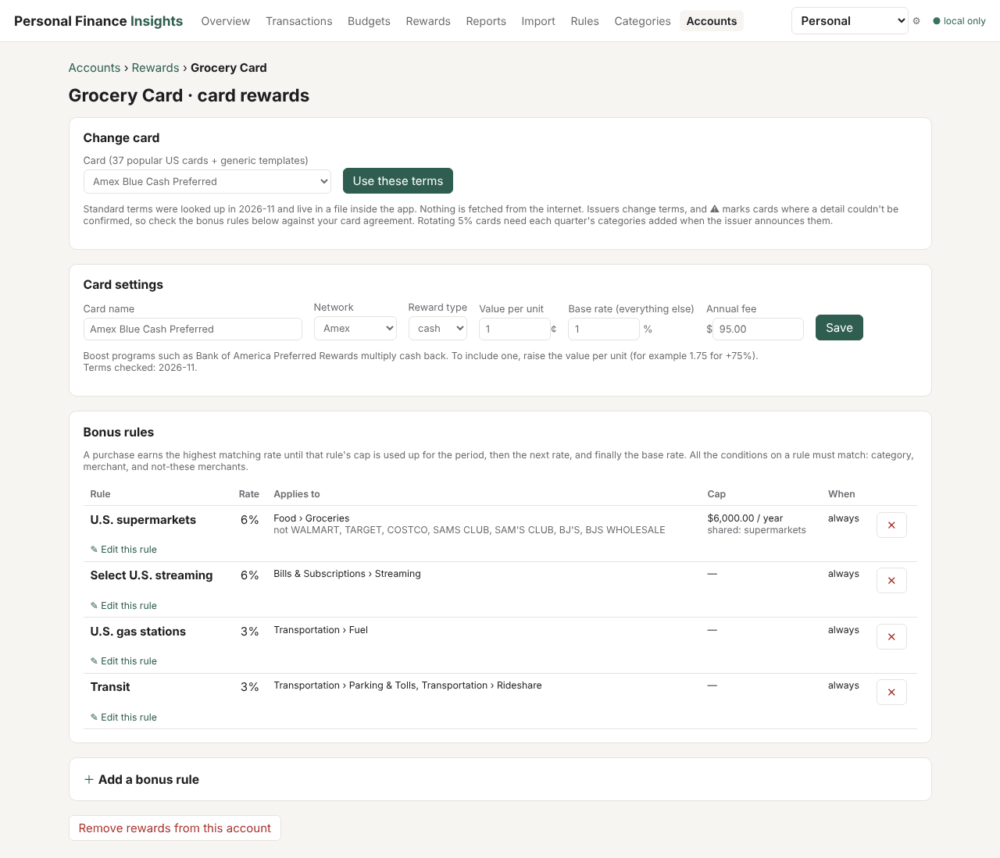
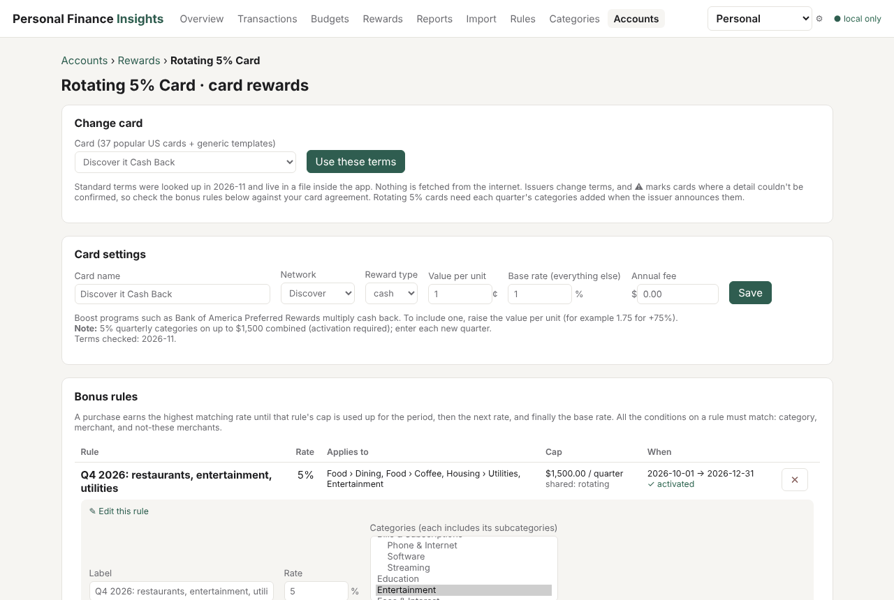
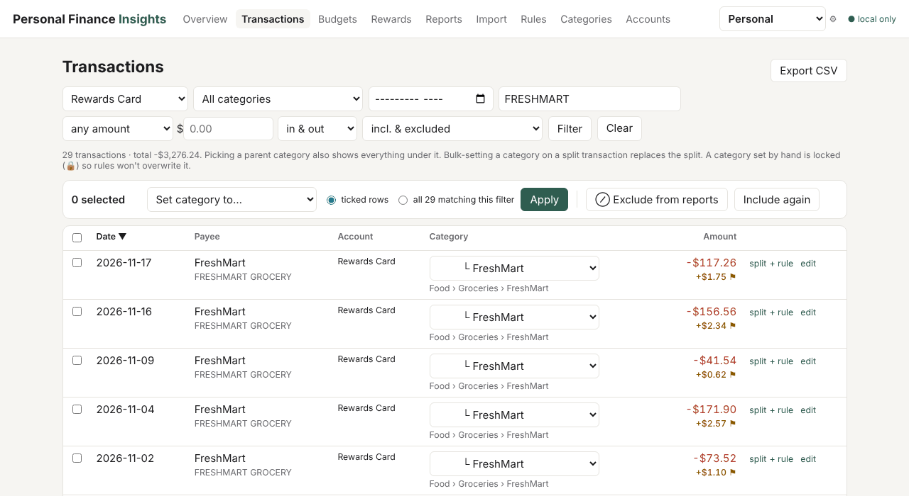
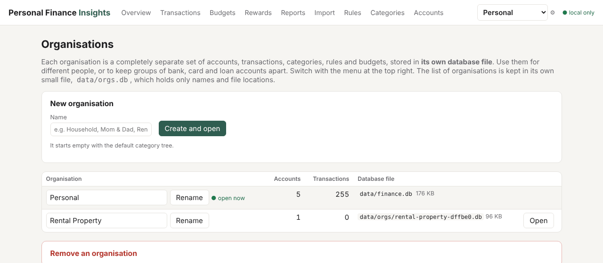

# Personal Finance Insights

Private, local-only budgeting and spending insights.

It runs on your own computer and nothing else. There is no account, no cloud, no telemetry, no AI, and no calls to outside services.
- The server listens on `127.0.0.1` only, so other devices on your Wi-Fi can't connect.
- Pages may only load files from the app itself (a Content-Security-Policy blocks every outside source).
- Requests are refused if they don't come from `localhost`/`127.0.0.1` (this stops DNS-rebinding attacks) or if they're cross-site form posts (this stops CSRF). Other websites open in your browser can't reach the app's data.
- All your data is in SQLite files in the `data` folder: `data/finance.db`, plus one file per extra [organisation](#organisations).

It runs on **Windows, macOS and Linux**.

## Run it

You need **Python 3.11 or newer** (3.10 also works). The first start creates a private Python environment in the app's folder (`.venv`), which takes about a minute. After that the app opens in your browser at http://127.0.0.1:8765. To stop it, close the terminal window or press **Ctrl+C** in it.

Get the code with `git clone https://github.com/prasadchawak/PersonalFinanceInsights.git`, or download it as a ZIP from GitHub and unzip it.

### Windows

1. Install Python from [python.org](https://www.python.org/downloads/). During setup, tick **"Add python.exe to PATH"**.
2. Put the folder somewhere, for example `C:\Users\you\PersonalFinanceInsights`.
3. Double-click **`run.bat`**.

### macOS

1. Install Python 3.11 or newer, either with the installer from [python.org](https://www.python.org/downloads/macos/) or with Homebrew: `brew install python@3.12`. The `python3` that comes with Xcode's command line tools is too old.
2. Open **Terminal**, go to the folder, and start the app:
   ```sh
   cd ~/PersonalFinanceInsights
   sh run.sh
   ```
   (`./run.sh` works too. If macOS says the file isn't executable, which can happen after a ZIP download, use `sh run.sh` or run `chmod +x run.sh backup.sh` once.)

### Linux

1. Install Python and its venv module:
   - **Ubuntu / Debian:** `sudo apt install python3 python3-venv`
   - **Fedora:** `sudo dnf install python3`
   - **Arch:** `sudo pacman -S python`
2. In a terminal:
   ```sh
   cd ~/PersonalFinanceInsights
   sh run.sh
   ```
3. If your distribution's Python is older than 3.10, install a newer one and point the script to it: `PYTHON=python3.12 sh run.sh`.

On a machine with no desktop, set `PFI_NO_BROWSER=1` so the app doesn't try to open a browser. It still only accepts connections from that same machine.

### Everyday commands

| | Windows | macOS / Linux |
|---|---|---|
| Start the app | double-click `run.bat` | `sh run.sh` |
| Back up all data | double-click `backup.bat` | `sh backup.sh` |
| Run the app's Python | `.venv\Scripts\python` | `.venv/bin/python` |
| Set a setting for one start | `set PFI_PORT=8766` then `run.bat` | `PFI_PORT=8766 sh run.sh` |
| Where your data is | `data\` | `data/` |

## Quick help

All screenshots use made-up demo data (see [Try it with demo data](#try-it-with-demo-data)).

**Contents:** [Getting started](#getting-started) · [Importing](#importing-statements) · [Transactions](#working-with-transactions) · [Splitting](#splitting-a-transaction) · [Rules](#rules) · [Categories](#categories) · [Budgets](#budgets) · [Reports](#reports) · [Card rewards](#credit-card-rewards) · [Leaving money out of reports](#leaving-money-out-of-reports) · [Organisations](#organisations) · [Troubleshooting](#troubleshooting)

### Getting started

1. **Accounts →** add each account you track (checking, savings, credit card, loan). Set its *opening balance* to the balance just before the first transaction you'll import. Enter money owed on cards and loans as a negative number.
2. **Import →** upload a statement for each account (see below).
3. **Transactions →** give uncategorised transactions a category. Use **+ rule** on any row so the next import does it for you.
4. **Budgets →** set monthly limits. **Overview** and **Reports** fill in by themselves.


*Overview: this month's totals, spending by category, balances, the budgets closest to their limit, and the last six months.*

### Importing statements

- Download **OFX / QFX** ("Quicken" / "Web Connect") from your bank if it's offered: it imports with no setup.
- With **CSV**, the first file from each bank opens this mapping screen. Check the guessed columns and the preview, then import. Purchases must show red (negative). If they don't, tick **Flip sign**. The layout is remembered, so next time it's one click.
- Re-importing overlapping dates is safe, because duplicates are skipped. Every import can be **undone** from the import history.


### Working with transactions

- **Filter** by account, category (a parent includes its subcategories), month, text, **amount** (equals / more than / at least / less than / at most / between, typed as positive numbers) and **money in or out**. Typing a number such as `24.85` in the search box finds that exact amount.
- **Sort** by clicking any column header; click again to reverse.
- **Bulk edit:** tick rows (the header box ticks the whole page) or choose *all matching this filter*, then set a category, or **⊘ Exclude from reports** / **Include again**.
- On each row: **split** · **+ rule** (make a rule from this payee) · **edit** (rename the payee, add a note, exclude from reports). 🔒 means the category was set by hand, so rules won't change it.
- **Export CSV** downloads exactly what the current filter shows.


### Splitting a transaction

Click **split** to divide one charge across categories, for example a store trip that was mostly household items plus some groceries. Enter each part as a positive number. **Remaining** must reach $0.00, and *Put the remainder on the last filled line* does the arithmetic for you. Reports and budgets use the parts.



### Rules

A rule fires when **all** its conditions match:
- any number of text tests: contains, doesn't contain, starts with, equals, regex
- an amount: type a positive number and choose money out or in
- an account

It then sets a category, can rename the payee, and can exclude the transaction from reports.

- **The first matching rule wins.** Lower priority numbers run first. Put specific rules (e.g. *marketplace AND more than $150*) at a lower number than general ones (*marketplace*).
- **Matches** shows how many transactions each rule catches. *"+N taken by earlier rule"* means a higher-priority rule got there first: lower this rule's number.
- Saving a rule only touches **uncategorised** transactions unless you choose *re-apply to all*, or *…including hand-set 🔒*.


### Categories

Categories can be up to **3 levels** deep, for example Food › Groceries › FreshMart. On this page you can:
- add a category, rename it, or move it (with everything under it) to a new parent
- delete a category: its subcategories and transactions move up to its parent
- **⊘ exclude** a category (see [Leaving money out of reports](#leaving-money-out-of-reports))

Use a *transfer* kind for card payments and moves between your own accounts, so they're never counted as spending.



### Budgets

Type a monthly amount next to any category. Then choose to save it as your **usual monthly budget**, or **only for this month** (enter 0 to skip a category for one month). A parent's spending includes its subcategories, and totals never count a parent and its children twice. Bars turn amber at 90% and red with **⚠ over** past 100%.


### Reports

Every report has a period picker (this month … all time, or custom dates), an account filter, and a table under the chart. Click any row to see its transactions. Hover over a bar or slice for the exact amount.

| Report | What it answers |
|---|---|
| **Spending / Income by category** | Where the money went. Choose **Pie or Bar**, how deep to break down (levels 1–3), or **Subcategories of** one category. |
| **Income vs expenses** | Monthly income, spending, net and savings rate. |
| **Spending over time** | Month-by-month for all spending or any one category. |
| **Merchants** | Who you pay most, as a pie or bar. Click a merchant for its trend and categories. |
| **Net worth** | Assets, debts and net worth at each month end. |




### Credit card rewards

Estimates what each credit card purchase earns, which card to use for what, and what you're missing. It works **entirely offline**: rewards are worked out from card terms plus your own transactions, and nothing is fetched or sent anywhere.

**Setting up a card**
1. On **Accounts**, any account with type **credit** shows **💳 set up rewards**. You can also start from the **Rewards** tab.
2. Pick the card from the built-in list: **37 popular US cards** (Chase, Amex, Citi, Capital One, Wells Fargo, Bank of America, Discover, U.S. Bank, Apple, Robinhood, and airline and hotel cards) plus generic flat-rate templates. The account's name pre-selects the card when it can.
3. Check the **bonus rules** it fills in: rate, categories (each includes its subcategories), merchants, a cap per month, quarter or year, dates, and whether the bonus needs activation. Edit or add rules to match your card agreement.
4. In **Card settings**, set the **value per point** for points and miles cards (so 1.5¢ Delta miles and 1¢ cash back compare fairly), the network, the annual fee, and any boost. For example, Bank of America Preferred Rewards +75% is entered as a value of 1.75.



**How earnings are estimated**
- A purchase earns the highest matching rate until that rule's cap is used up for the period, then the next rate, and finally the base rate. A purchase that crosses a cap is split at the cap. Rules with the same *shared cap name* share one cap, as with Bank of America's choice category plus groceries.
- **Refunds** take back what they earned. **Card payments and transfers** earn nothing. **Split** transactions earn per part. Transactions you've **⊘ excluded** from reports still earn, because exclusion is about budgeting, not about what the card pays you.
- **Rotating 5% cards** need each quarter's categories added, with dates, the $1,500 cap and "needs activation". The Rewards page reminds you when a quarter has none, when a bonus isn't activated, when a cap is nearly used, when a card hasn't been used for 5 months (issuers may close it), and when card terms are more than 6 months old.
- Cards are only suggested where they're accepted. For example, Costco US takes Visa only.



**The Rewards tab**
- **Which card to use, right now:** for what you actually buy on your cards, the card that pays most today, taking remaining caps and end dates into account, plus the runner-up. The top five also appear on the **Overview**.
- **By card:** spending, estimated rewards, effective return %, annual fee, net value for the period, and last used date.
- **Missed rewards:** by category and by merchant, compared with the best card you hold for each purchase (that card's caps included). Spending from checking, such as rent, isn't counted as missed.


On **Transactions**, each card purchase shows its estimated reward, and **⚑** marks one where another of your cards would have earned more. Hover over it to see which card.



> **About accuracy:** these are estimates. Issuers decide rewards using the merchant's code (MCC), which bank exports rarely include, so the app relies on your categories and on merchant names. Caps use calendar periods, while some issuers use billing cycles. The built-in card terms were checked in November 2026 and ⚠ marks cards with a detail that couldn't be confirmed. Always compare against your card agreement. The list lives in [`tools/build_card_catalog.py`](tools/build_card_catalog.py) and contains public product terms only, never anyone's cards. To update it, edit that file and run `python tools/build_card_catalog.py`.

### Leaving money out of reports

Some money would be counted twice. Example: you already count $400 a month going into a savings fund. If you later pay a $640 car repair *from* that fund and count it too, the same money shows up twice. **⊘ Exclude** the repair, and it stays out of reports and budgets. You can exclude:
- one transaction: **edit** → *Leave out of reports & budgets*
- many at once: the bulk bar
- a whole category, e.g. *Paid from savings fund*: tick **⊘ exclude** on Categories
- automatically: a rule with *and ⊘ exclude from reports & budgets*

Excluded rows stay visible (dimmed, marked ⊘) and **still count in balances and net worth**. Every report says what was left out: *"⊘ Not counted here: 1 excluded transaction ($640.00 out)"*.

### Organisations

Use organisations to keep separate books, for example for another person, a rental property or a business. Each has its own accounts, categories, rules and budgets, in **its own database file**. Switch with the menu at the top right. **⚙** lets you create, rename or remove one; a removed organisation's file is moved to `data/deleted/`, not erased.



### Troubleshooting

| Problem | What to do |
|---|---|
| A rule doesn't change anything | Check **Matches**: *"taken by earlier rule"* means lower its priority number. Transactions with 🔒 (set by hand) or a split are skipped unless you re-apply *including hand-set*. |
| Totals don't match my bank statement | Card payments and transfers should use a *transfer* category, so they aren't counted as spending. Check for **⊘ excluded** transactions (each report shows them). For balances, check each account's **opening balance**. |
| CSV amounts are backwards | Delete that layout under *Import → Saved CSV layouts*, re-import, and tick **Flip sign**. |
| I imported the wrong file | *Import → history → Undo* removes everything that import added. |
| Page says *Cross-site request blocked* | Open the app at `http://127.0.0.1:8765` (not another address or a bookmark to an old port). |
| A card's rewards look wrong | Open the card from **Rewards → By card** and check its bonus rules: categories (anything shown as *needs a category* isn't mapped yet), the cap and period, dates, and whether the bonus is marked **activated**. Purchases need categories to match category bonuses. |
| Port 8765 is already in use | Windows: `set PFI_PORT=8766` then `run.bat`. macOS/Linux: `PFI_PORT=8766 sh run.sh`. |
| Starting fresh / moving computers | Stop the app and copy the whole `data` folder; it works across Windows, macOS and Linux. Run a backup (`backup.bat` or `sh backup.sh`) before any upgrade. |
| `run.sh` says Python is missing or too old (macOS/Linux) | Install Python 3.11+ as described in [Run it](#run-it), or point to a newer one: `PYTHON=python3.12 sh run.sh`. |
| "Could not create the environment" (Linux) | Install the venv module: `sudo apt install python3-venv` on Debian/Ubuntu. |

### Try it with demo data

Start the app once first (so `.venv` exists), stop it, then:

**Windows**
```
.venv\Scripts\pip install -r requirements-dev.txt
.venv\Scripts\python tools\make_demo.py demo-data
set PFI_DATA_DIR=demo-data
run.bat
```

**macOS / Linux**
```sh
.venv/bin/pip install -r requirements-dev.txt
.venv/bin/python tools/make_demo.py demo-data
PFI_DATA_DIR=demo-data sh run.sh
```

This builds a separate folder of made-up accounts, transactions and three demo credit cards with rewards set up, which are the ones in these screenshots. To regenerate the screenshots, see [`tools/take_screenshots.py`](tools/take_screenshots.py). Your real `data` folder isn't touched. Delete `demo-data` when you're done.

## First use (detailed reference)

1. **Accounts:** add each account you'll track. Set its opening balance to the balance just before the oldest transaction you'll import. Enter what you owe on cards and loans as a negative number.
2. **Import:** download a statement from your bank and upload it.
   - **OFX/QFX** (often labeled "Quicken", "Money" or "Web Connect") is best. It's a standard format, so it imports with no setup and duplicates are matched exactly.
   - **CSV:** the first time you import from a bank, the app shows the file and guesses which column is which. You confirm the guess, check that purchases show as negative (tick **Flip sign** if they don't), and import. The app remembers that layout from the file's header row, so later imports from the same bank are a single click.
   - Re-importing an overlapping date range is safe because duplicates are skipped. Two identical charges on the same day (two coffees) are both kept.
   - Every import can be undone from the import history.
3. **Categorize:** pick a category on each transaction, or click **+ rule** to make a rule such as "description contains COSTCO → Groceries, rename to Costco". Rules run on every future import. A category you set by hand is locked, so rules never overwrite it.
4. **Categories** can be up to 3 levels deep (e.g. Food › Groceries › Costco). On the Categories page you can add, rename, move a category (along with everything under it) to a new parent, or delete it. When you delete one, its subcategories and transactions move up to its parent. Filtering or reporting on a parent includes everything under it.
5. **Bulk edit:** on Transactions, tick rows (or use the header checkbox to tick the whole page), pick a category in the bar above the table and click Apply. Choose "all N matching this filter" to recategorize every transaction that matches the current filter, not just the visible page.
6. **Reports:** spending by category and income by category (pie or bar, rolled up to level 1, 2 or 3, with a click-through to break any category down further), income vs expenses by month with net and savings rate, spending over time for any category, net worth at each month end, and merchants. Every report has a period picker (this month, last 3/6/12 months, year to date, last year, all time, or custom dates) and an account filter, plus a table you can click through to the matching transactions. Charts are drawn by the app itself; nothing is loaded from the internet.
7. **Split transactions:** click **split** on any transaction to divide it across categories, for example one Costco charge split into Groceries and Household. The editor shows how much is left to assign, and the parts must add up exactly. Reports, budgets and filters all use the split parts. Rules never change a split transaction, and choosing a single category for it (or bulk-setting one) replaces the split.
8. **Budgets:** set a monthly amount for any category or subcategory. Save it as your usual monthly budget, or for one month only. A parent's spending includes everything under it, and totals never count a parent and its children twice. The Overview page shows the budgets closest to their limit.
9. **Merchants report:** spending by merchant as a pie or bar chart, optionally within one category. Click a merchant to see its month-by-month trend and which categories it falls under. To merge name variants into one merchant, use a rule's "rename payee".
10. **Accounts and rules can be edited:** rename an account or change its type and opening balance. To **delete** an account, open "Delete an account" on the Accounts page and type its name to confirm. This permanently removes its transactions (including splits), its import history and any rules limited to that account. Run a backup first (`backup.bat`, or `sh backup.sh` on macOS/Linux).
11. **Rules with several conditions (AND):** a rule can combine any number of text conditions (description or memo, description only, or memo only; using contains, doesn't contain, starts with, equals or matches regex) with an amount test and a money-in or money-out choice, plus an account. All of them must match. "Description" matches both the bank's original text and the name shown in the app after a rename. **Amounts are typed as positive numbers** (e.g. 24.85), with equals, more than, at least, less than, at most or between, and **money out or in is picked separately**. A typed minus sign is read as "money out", and an amount typed while "any amount" is selected means "equals". Example: description contains "AMAZON" **and** amount more than $200 **and** money out → Electronics. For "either A or B", make two rules. Each rule shows how many transactions it currently matches, and flags "taken by earlier rule" when a rule with a lower priority number (or an older one with the same priority) catches them first; give the rule a lower number (0 is allowed) to fix that. Rules never replace categories you set by hand (🔒) unless you choose "re-apply to all, including hand-set".
12. **Sorting:** click any column header on Transactions (date, payee, account, category or amount) to sort by it, and click again to reverse. Sorting keeps your filters.
    **Amount filters:** on Transactions, filter by amount (equals, more than, at least, less than, at most, between; always positive numbers) and by money out or in. These combine with the other filters, sorting, bulk edit and CSV export. Typing a number such as `24.85` or `$3,200` into the search box also finds transactions of exactly that amount.
13. **Transfers:** card payments and moves between your own accounts belong in a *transfer* category, so they aren't counted as spending twice.
14. **Organisations:** keep completely separate sets of accounts, for different people or for groups such as household, rental property or business. Each organisation has its own accounts, transactions, categories, rules and budgets, stored in **its own database file** (`data/finance.db` for the first one, called "Personal"; new ones go in `data/orgs/`). The list of organisations is kept in a separate small file, `data/orgs.db`, which holds only names and file locations. Switch with the menu at the top right. Your browser remembers the last one you opened. Manage organisations with ⚙: create, rename, or remove. Removing one moves its file to `data/deleted/` instead of erasing it.
15. **Leave out of reports and budgets (⊘ exclude):** some money would otherwise be counted twice. For example, you budget and track $X a month going into a savings fund, and later an expense Q is paid from that fund. Counting both X and Q double-counts the same money, so mark Q as excluded. You can exclude:
    - a single transaction (**edit** → "Leave out of reports & budgets"),
    - many at once (tick them, or use "all matching this filter", then **⊘ Exclude from reports** or **Include again**),
    - a whole category and everything under it (Categories page, **⊘ exclude**; e.g. a "Paid from savings fund" category),
    - automatically, with a rule ("and ⊘ exclude from reports & budgets").

    Excluded transactions still show on Transactions (marked ⊘ and dimmed), and the filter there can show only excluded or hide them. They're still part of account balances and net worth, because the money really moved. Overview, Reports and Budgets each say how much was left out, with a link to those transactions. The CSV export has an `excluded_from_reports` column.

## Backups

On Windows double-click **`backup.bat`**; on macOS or Linux run **`sh backup.sh`**. It writes a consistent snapshot of **every organisation's database plus the organisation list** to a dated folder in `data/backups/`, and is safe to run while the app is open. Copy those files to an external drive or another place you trust.

To restore, stop the app and copy the backed-up files back into the `data` folder (`orgs.db` to `data/`, `finance.db` to `data/`, and any `orgs/*.db` to `data/orgs/`).

Recommended: turn on full-disk encryption so the database is encrypted at rest if the computer is lost: **BitLocker** (or Device Encryption) on Windows, **FileVault** on macOS, and **LUKS** on Linux (usually chosen when installing the system).

## Settings (environment variables)

| Variable | Default | Purpose |
|---|---|---|
| `PFI_PORT` | `8765` | Port to listen on |
| `PFI_DATA_DIR` | `data` in the app folder | Where the database and backups live |
| `PFI_NO_BROWSER` | unset | Set to `1` to stop the app opening the browser on start |

The older `TALLY_*` names still work.

**Upgrading from Tally:** this app used to be called Tally. On first start, an existing `data/tally.db` is renamed to `data/finance.db` automatically (only when no `finance.db` exists yet), so all your data carries over.

## How it's built

```
app/
  db.py              SQLite schema; money is stored as integer cents (no floating-point rounding)
  normalize.py       amount/date parsing, payee cleanup, fingerprints
  importers/ofx.py   OFX/QFX parser (SGML and XML versions)
  importers/csv_import.py   header detection, column guessing, mapping-driven parsing
  rules.py           first-match categorization rules
  splits.py          split transactions
  rewards.py         credit card rewards: earn rules, caps, best card, missed rewards, alerts
  data/card_catalog.json   built-in card terms (generated by tools/build_card_catalog.py)
  budgets.py         monthly budgets (default + per-month override, parent roll-up)
  categories.py      3-level category tree: paths, roll-ups, safe rename/move/delete
  reports.py         report queries (period ranges, roll-ups, cash flow, net worth)
  charts.py          server-rendered SVG charts (pie, bar, column, line)
  services.py        import pipeline (dedupe, rules), balances, monthly summary
  main.py            web app (FastAPI + server-rendered pages)
tests/               pytest suite, run against made-up sample files
```

How duplicates are detected: an OFX transaction is identified by the bank's own FITID. A CSV transaction is identified by a hash of `(date, amount, description, n-th occurrence in file)`, stored together with its account.

To run the tests: `pip install -r requirements-dev.txt` then `pytest`.

## Roadmap

- **Phase 2:** monthly budgets compared with actual spending
- **Phase 3:** PDF export of reports
- **Phase 4:** mortgage extra-payment scenarios
- **Phase 5:** Docker image, passkey sign-in, encrypted backups, home-server deployment (Option 2)

## License

[MIT](LICENSE) © 2026 prasadchawak
