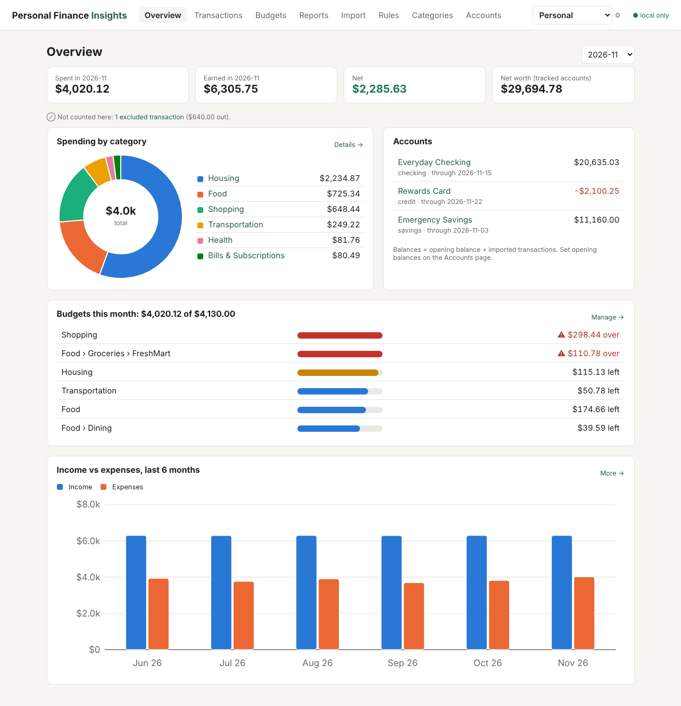

# Personal Finance Insights

Private, local-only budgeting and spending insights. It runs on your own computer and nothing else: no account, no cloud, no telemetry, no AI, and no calls to outside services. Works on **Windows, macOS and Linux**.

## Why it's private

- The server listens on `127.0.0.1` only, so other devices on your Wi-Fi can't connect.
- Pages may only load files from the app itself: a Content-Security-Policy blocks every outside source.
- Requests are refused unless they come from `localhost`/`127.0.0.1` (this stops DNS-rebinding attacks), and cross-site form posts are refused (this stops CSRF). Other websites open in your browser can't reach your data.
- Your data is plain SQLite files in the `data` folder: `data/finance.db`, plus one file per extra organisation. Back them up by copying them.

How this is enforced: [Architecture → Security model](docs/architecture.md#security-model).

## What it does

- **Import** bank statements: OFX/QFX with no setup, or CSV from any bank with a column mapping it remembers. Re-importing is safe and every import can be undone.
- **Categorise** with a 3-level category tree, bulk edit, split transactions, and rules that combine text, amount and direction conditions.
- **Budget** monthly, with a usual amount and one-month overrides.
- **Report** spending and income by category (pie or bar, any level), income vs expenses, trends, merchants and net worth.
- **Leave out** transactions or whole categories that would be counted twice, while keeping balances correct.
- **Organisations:** separate books (another person, a rental, a business), each in its own database file.
- **Credit card rewards:** estimated rewards per purchase from 37 built-in card profiles, which card to use for what, and what you're missing, all offline.

## Quick start

| | Windows | macOS | Linux |
|---|---|---|---|
| 1. Install Python 3.11+ | [python.org](https://www.python.org/downloads/) (tick *Add python.exe to PATH*) | [python.org](https://www.python.org/downloads/macos/) or `brew install python@3.12` | `sudo apt install python3 python3-venv` (Ubuntu/Debian) |
| 2. Get the code | [Download ZIP](https://github.com/prasadchawak/PersonalFinanceInsights/archive/refs/heads/main.zip) or `git clone` | same | same |
| 3. Start | double-click `run.bat` | `sh run.sh` in Terminal | `sh run.sh` |
| Back up | double-click `backup.bat` | `sh backup.sh` | `sh backup.sh` |

The first start takes about a minute to set up, then the app opens at http://127.0.0.1:8765. Full instructions, settings and troubleshooting: [Install and run](docs/install.md).

## Documentation

| For | Read |
|---|---|
| Installing, settings, backups, upgrading | [docs/install.md](docs/install.md) |
| A tour of every page, with screenshots | [docs/user-guide.md](docs/user-guide.md) |
| Every feature in detail | [docs/reference.md](docs/reference.md) |
| Credit card rewards | [docs/rewards.md](docs/rewards.md) |
| Changing default categories or the card catalog | [docs/customizing.md](docs/customizing.md) |
| How it's built (diagrams, data model, security) | [docs/architecture.md](docs/architecture.md) |
| Developing: setup, tests, conventions, recipes | [docs/development.md](docs/development.md) |
| AI assistants working on this repository | [CLAUDE.md](CLAUDE.md) |

## Roadmap

- **Next:** PDF export of reports; mortgage extra-payment scenarios.
- **Self-hosted version:** Docker image, passkey sign-in, encrypted backups, running on a home server so you can use it from your phone.

## License

[MIT](LICENSE) © 2026 prasadchawak
