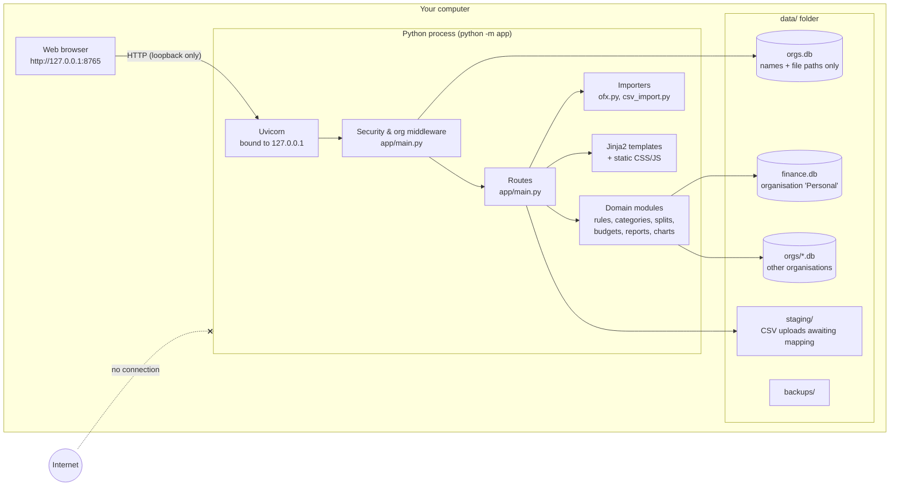
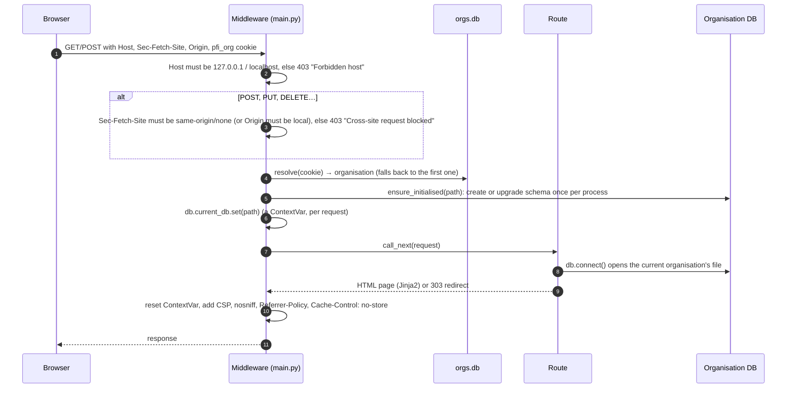
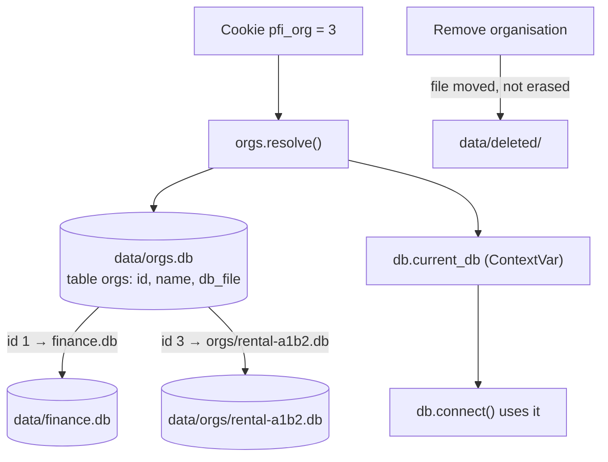
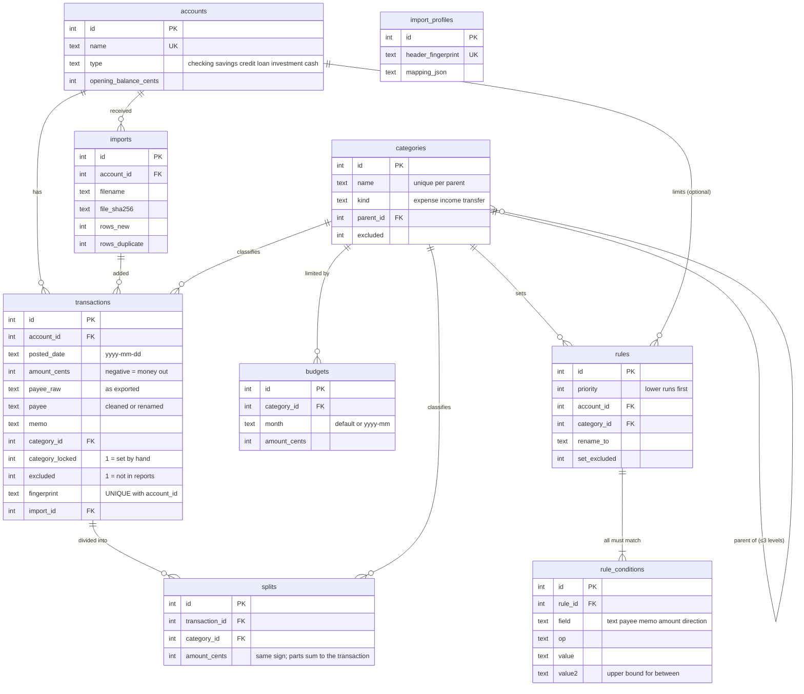
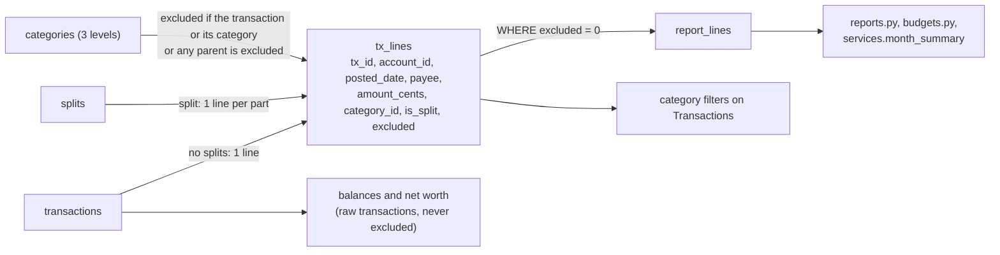
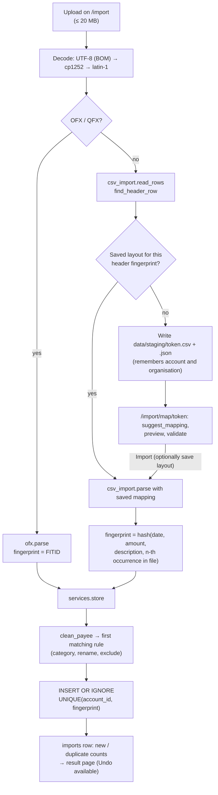
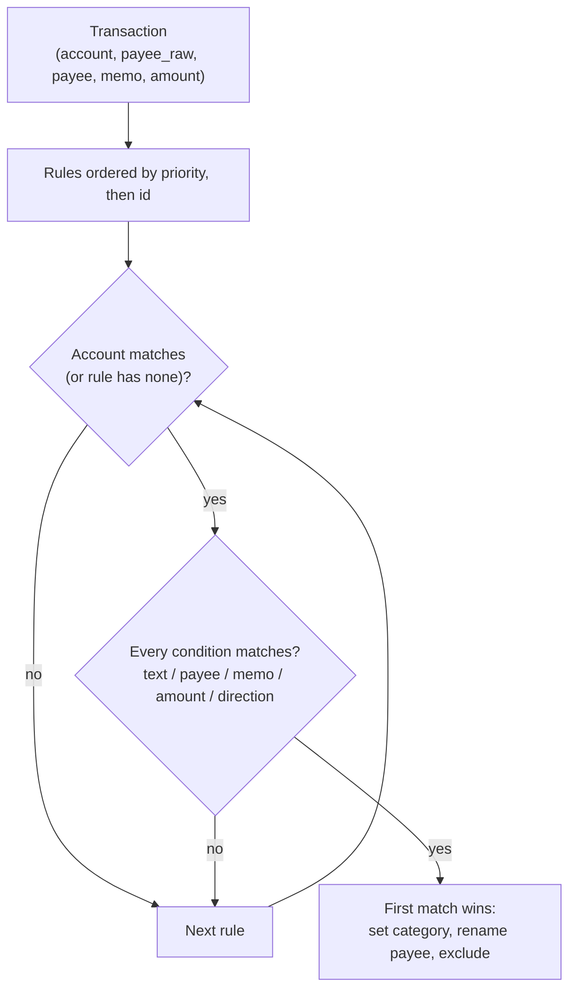

# Architecture

How Personal Finance Insights is built, and why. Read this before changing anything structural. For day-to-day development (setup, tests, conventions, adding a page), see [development.md](development.md).

**Contents:** [Goals](#goals-and-constraints) · [System overview](#system-overview) · [Modules](#modules) · [Request lifecycle](#request-lifecycle) · [Security model](#security-model) · [Storage and organisations](#storage-and-organisations) · [Data model](#data-model) · [Lines and report views](#lines-and-report-views) · [Import pipeline](#import-pipeline) · [Rules engine](#rules-engine) · [Categories](#categories) · [Budgets and reports](#budgets-and-reports) · [Charts](#charts) · [Schema changes](#schema-changes-and-migrations) · [Design decisions](#design-decisions)

## Goals and constraints

These are the rules the whole design follows. A change that breaks one of them is a bug, however useful it looks.

| # | Constraint | How it's enforced |
|---|---|---|
| 1 | **Your data never leaves your computer.** No cloud, no telemetry, no AI, no outside services. | No HTTP client in the code; the only dependencies are FastAPI, Uvicorn, Jinja2 and python-multipart. |
| 2 | **Nothing on the network can reach the app.** | Uvicorn binds to `127.0.0.1` only (`app/__main__.py`). |
| 3 | **Other websites open in your browser can't reach it either.** | Host-header check (DNS rebinding) and Sec-Fetch-Site / Origin check (CSRF) in the middleware. |
| 4 | **Pages load nothing from outside.** | `Content-Security-Policy: default-src 'self'`; charts are server-rendered SVG; no CDNs or web fonts. |
| 5 | **Money is exact.** | Stored and computed as **integer cents**. |
| 6 | **Your data is plain files you control.** | One SQLite file per organisation in `data/`; backups are file copies. |
| 7 | **Easy to run anywhere.** | Pure Python 3.10+, no build step, no Node, no database server. `run.bat` / `run.sh` do everything. |

## System overview

Everything is server-rendered HTML. The browser receives a complete page for every request, forms POST back and are answered with a redirect (POST → redirect → GET). The only JavaScript is `app/static/app.js` (about 90 lines): auto-submitting dropdowns, select-all checkboxes and showing the custom date range. Every page works without it except select-all.

## Modules

| Module | Responsibility | Depends on |
|---|---|---|
| `app/__main__.py` | Entry point: reads `PFI_PORT`, opens the browser, starts Uvicorn on 127.0.0.1 | — |
| `app/main.py` | FastAPI app: lifespan start-up, security/org middleware, **all routes**, form parsing, template rendering | everything below |
| `app/db.py` | Paths and settings, SQLite connection, schema, default categories, views, migrations | — |
| `app/orgs.py` | Organisation registry (`data/orgs.db`): create, rename, remove, resolve from cookie | `db` |
| `app/normalize.py` | Parse dates and amounts, clean payee names, fingerprints | — |
| `app/importers/ofx.py` | OFX/QFX (SGML 1.x and XML 2.x) → `ParsedTxn` | `normalize` |
| `app/importers/csv_import.py` | Find header row, guess columns, validate a mapping, parse rows → `ParsedTxn` | `normalize` |
| `app/services.py` | Store an import (dedupe + rules), undo an import, balances, month summary | `rules` |
| `app/rules.py` | Rule conditions, validation, first-match evaluation, re-apply, match counts | — |
| `app/categories.py` | 3-level category tree: load, paths, descendants, create/rename/move/delete | — |
| `app/splits.py` | Save and remove splits (parts must add up exactly) | — |
| `app/budgets.py` | Default and per-month budgets, roll-up of spending into parents | `categories` |
| `app/reports.py` | Period ranges and all report queries (category totals, cash flow, trends, net worth, merchants) | `categories` |
| `app/charts.py` | Pure functions returning SVG markup: donut, horizontal bars, columns, lines, progress | — |
| `app/backup.py` | Consistent snapshot of every organisation database + the registry | `db`, `orgs` |
| `app/templates/` | Jinja2 pages; `base.html` has the navigation and org switcher, `_macros.html` shared bits | — |
| `app/static/` | `style.css` (light and dark), `app.js` | — |

Domain modules take a `sqlite3.Connection` as their first argument and never import `main`. That keeps them testable on their own and keeps HTTP concerns in one file.

## Request lifecycle

Start-up (FastAPI `lifespan`) runs once: rename a legacy `tally.db` if present, create the registry, initialise/upgrade **every** organisation database, and create `data/staging/`.

## Security model

| Threat | Defence | Where |
|---|---|---|
| Another device on the network | Listen on `127.0.0.1` only | `app/__main__.py` |
| A malicious web page making your browser call the app (DNS rebinding) | Reject any `Host` other than `127.0.0.1`, `localhost` (and `testserver` for tests) | middleware |
| A malicious web page submitting a form to the app (CSRF) | For non-GET requests, require `Sec-Fetch-Site: same-origin`/`none`; for browsers without it, require a local `Origin`. Requests with neither header (curl, tests) are allowed, since they can't come from a web page. | middleware |
| Injected scripts or data leaving the page | CSP `default-src 'self'`, `form-action 'self'`, `frame-ancestors 'none'`, `base-uri 'none'`; Jinja2 autoescaping | middleware, templates |
| Leaking URLs (with filters) to other sites | `Referrer-Policy: same-origin` | middleware |
| Sensitive pages cached on disk | `Cache-Control: no-store` | middleware |
| Open redirects | `back()` only redirects to paths within the app | `main.py` |
| Path tricks in uploads | Upload names are reduced to the base name; staging tokens must match `[A-Za-z0-9_-]{10,40}` | `main.py` |
| SQL injection | Parameters (`?`) everywhere; the only built-in SQL fragments are from fixed lists (sort columns, operators) | all modules |
| Losing data | Deletes ask you to type the name; removed organisations are moved to `data/deleted/`; backups | routes, `orgs.py`, `backup.py` |

There is no login: the operating-system account is the security boundary. Encrypting the disk (BitLocker, FileVault, LUKS) protects the files at rest. Sign-in comes with the self-hosted version (see the roadmap).

## Storage and organisations

- **One SQLite file per organisation**, with the identical schema. Nothing joins across organisations, so separation is physical, not a `WHERE org_id = …`.
- `data/orgs.db` holds only names and file paths; tests assert it never holds financial data.
- `db.connect()` with no argument opens the request's organisation. Code outside a request (tests, tools) passes a path or uses the default `finance.db`.
- Connections use `PRAGMA foreign_keys = ON` and WAL journaling (fast reads while writing; `backup.py` uses SQLite's backup API so snapshots are consistent while the app runs).
- `PFI_DATA_DIR` moves the whole folder; `PFI_DB` overrides the first organisation's file (used by tests).

## Data model

`rules.match_type` and `rules.pattern` are left over from version 1 (one text test per rule). They're kept so old databases open; `db.init()` copies them into `rule_conditions` once. New code reads only `rule_conditions`.

## Lines and report views

A transaction that has been split must be counted per part everywhere, and excluded money must be left out of reports but kept in balances. Two SQL views (defined in `db.LINES_VIEW`, recreated on every start) do this once, so no query has to remember the rules:

**Rule of thumb:** reports and budgets read `report_lines`; anything about what a category contains reads `tx_lines`; balances read `transactions`.

## Import pipeline

- Duplicates are dropped by the database's `UNIQUE(account_id, fingerprint)` constraint, not by searching, so re-importing is always safe.
- The *n-th occurrence* in the CSV fingerprint keeps two genuinely identical rows (two coffees, same day, same price) while still recognising them on re-import.
- The original row is kept in `transactions.raw_json` for auditing.
- **Undo** deletes the transactions with that `import_id` (splits cascade).

## Rules engine

- Text tests are case-insensitive; *payee* tests check both the bank's text and the shown name; *doesn't contain* must hold for all of them.
- Amount conditions compare the **absolute** amount; *direction* holds the sign. A typed negative amount is normalised to "money out" by `validate_conditions`.
- **When rules run:** `services.store` (every import) and `rules.apply_all` (after saving a rule, or *Re-run rules*). `apply_all` never touches split transactions and skips locked (hand-set) categories unless asked.
- `match_counts` evaluates every rule against every transaction to show *Matches* and *taken by earlier rule*.

## Categories

- Stored as an adjacency list (`parent_id`), at most **3 levels** (`categories.MAX_DEPTH`). `categories.load()` returns a `Tree` with paths (`Food › Groceries`), depth, descendants and height.
- A child always has its top-level parent's `kind`. Moving a category re-kinds its whole subtree.
- Names are unique per parent, case-insensitive (index `ux_cat_name`).
- Deleting moves children, transactions and rules up to the parent; for a top-level category they become uncategorised, and rules left with no action are deleted.
- The default tree is `db.DEFAULT_CATEGORIES`, inserted only when an organisation's `categories` table is empty, i.e. when it's created. See [customizing.md](customizing.md#default-categories).

## Budgets and reports

- `budgets.amounts_for(month)`: the month's own row wins over `month = 'default'`.
- `budgets.overview` gives each category the spending of itself **and all its descendants**, so a parent includes its children. The budget total only counts a budget when no ancestor also has one, so a parent and its children are never counted twice.
- `reports.period_range` turns a preset (`this_month`, `last_month`, `3m`, `6m`, `12m`, `ytd`, `last_year`, `all`, `custom`) into an inclusive `yyyy-mm-dd` range. Anything unknown means this month.
- `reports.category_totals(level=n)` rolls each line up to its ancestor at level *n*. Transfers are never counted as spending or income.
- Net worth uses raw `transactions` plus opening balances at each month end.

## Charts

`app/charts.py` returns SVG strings (wrapped in `Markup`) that templates embed directly. No JavaScript and no chart library. At most 8 slices or bars per chart (7 named + "Other"), so colours are never reused. Colours come from CSS classes (`.s1`…`.s8`, `.s-other`) so dark mode is handled in `style.css`, and every mark has an SVG `<title>` for the hover tooltip. Every chart has a table under it with the same numbers.

## Schema changes and migrations

There is no migration framework. `db.init()` runs on every start, for every organisation, and must be **idempotent**:

1. `_migrate()`: one-off structural rebuilds (e.g. version 1 categories → tree).
2. `SCHEMA`: `CREATE TABLE/INDEX IF NOT EXISTS`, so new tables appear automatically.
3. `_add_columns()`: each `(table, column, definition)` in `ADDED_COLUMNS` is added if missing. New columns **must** have a default.
4. `LINES_VIEW`: views are dropped and recreated, so they can change freely.
5. Data fix-ups (e.g. old single-pattern rules → conditions), each written so running it twice does nothing.

Step-by-step instructions: [development.md → Changing the database](development.md#changing-the-database).

## Design decisions

| Decision | Why | Trade-off |
|---|---|---|
| Server-rendered pages, no front-end framework | Nothing to build, nothing loaded from CDNs, works with a strict CSP, easy to read | Pages reload on each action |
| SQLite, raw SQL, no ORM | One file per organisation, zero setup, easy backups; queries are visible and testable | Hand-written SQL |
| Integer cents | No floating-point rounding errors in balances or budgets | Format on display (`money` filter) |
| One database file per organisation | Real separation; removing one is moving a file | Nothing reports across organisations |
| SVG charts drawn in Python | No JS library, works with the CSP, accessible titles | Simpler charts |
| Rules are first-match, AND-only | Predictable: you can always see which rule won and why | "OR" needs two rules |
| Import dedupe by fingerprint + UNIQUE constraint | Re-importing is always safe; no fuzzy matching surprises | A bank changing its description text creates new rows |
| Loopback only, no login | Smallest attack surface for a single-user desktop app | Not reachable from a phone (the self-hosted version will add that, with sign-in) |
