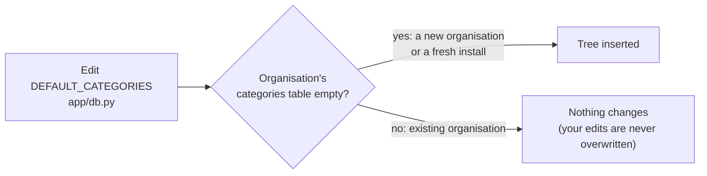
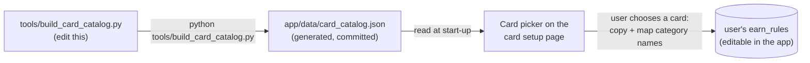

# Customizing

How to change what the app ships with: the **default categories**, the **credit card catalog** and a few other built-in lists. These are code changes for whoever maintains the repository. To change *your own* categories or cards, just use the app's pages.

**Contents:** [Default categories](#default-categories) · [Card catalog (rewards)](#card-catalog-rewards) · [Other built-in lists](#other-built-in-lists) · [After any change](#after-any-change)

## Default categories

Every **new** organisation starts with a category tree. It's defined in one place: `DEFAULT_CATEGORIES` in [`app/db.py`](../app/db.py).

```python
# (name, kind, [children]) — a sensible starting tree; rename/move/delete freely in the app.
DEFAULT_CATEGORIES = [
    ("Food", "expense", ["Groceries", "Dining", "Coffee"]),
    ("Housing", "expense", ["Rent / Mortgage", "Utilities", "Maintenance", "Home Insurance"]),
    ...
    ("Income", "income", ["Salary", "Interest & Dividends", "Refunds", "Other Income"]),
    ("Transfers", "transfer", ["Credit Card Payment", "Between My Accounts", "Investment Contribution"]),
]
```



### To add, rename or remove a default category

1. Edit `DEFAULT_CATEGORIES` in `app/db.py`. Each entry is `(top-level name, kind, [child names])`.
   - **kind** is `"expense"`, `"income"` or `"transfer"`. Children get their parent's kind.
   - The defaults are **two levels**. Users can add a third level in the app; keep the defaults at two so there's room.
   - Names must be unique among siblings (case-insensitive).
   - Card payments and moves between accounts must stay under a `"transfer"` category, or they'll be counted as spending.
2. Check the names the code relies on (search for them before renaming):
   - Tests look categories up by name (`Food`, `Groceries`, `Coffee`, `Dining`, `Fuel`, `Household`, `Housing`, `Shopping`, `Travel`, `Utilities`, `Salary`, `Other Income`, `Other Expenses`…): `grep -rn 'cat_id("' tests/`.
   - `tools/make_demo.py` uses them for demo data.
   - The **card catalog** refers to categories **by name** (`Dining`, `Coffee`, `Groceries`, `Fuel`, `Streaming`, `Travel`, `Flights`, `Lodging`, `Rideshare`, `Parking & Tolls`, `Pharmacy`, `Entertainment`, …). If you rename one, update the constants at the top of `tools/build_card_catalog.py` and regenerate the catalog, or new card setups will show *needs a category*.
3. Run the tests: `python -m pytest -q`.
4. Check it in a fresh data folder: `PFI_DATA_DIR=/tmp/cat-test python -m app` and open **Categories**.
5. Update the category list in [reference.md](reference.md#categories) if you mention specific names there.

### Existing organisations don't change

The default tree is only inserted when an organisation has **no categories at all**, so editing `DEFAULT_CATEGORIES` never touches anyone's existing tree. To give existing users a new category you have two options:
- **Tell them to add it** on the Categories page (simplest; it's their tree).
- **Add it in an upgrade step** in `db.init()`, guarded so it runs once and never duplicates or overrides their choices, e.g. insert *Pets* only if no top-level category called *Pets* exists. Add a test. Use this sparingly: users may have deliberately deleted a default.

## Card catalog (rewards)

The catalog is the list of cards users can pick on the card setup page. It contains **public product terms only**; nobody's own cards are ever in the repository. Users' choices and edits live in their own database (`card_programs`, `earn_rules`).



> **Never edit `card_catalog.json` by hand.** It's regenerated from the Python file, and your edit would be lost.

### Add a card

1. Open [`tools/build_card_catalog.py`](../tools/build_card_catalog.py) and add a `card(...)` entry to `CARDS`, in the section that fits (flat-rate, category cash back, travel, airline, hotel). Example, a made-up card:

   ```python
   card("example-bank-dining", "Example Bank Dining Rewards", "Example Bank", "Visa", "points", 1.25, 9500, 1.0,
        [rule("Dining", 4, categories=DINING),
         rule("Groceries", 3, categories=GROCERY, exclude=["WALMART", "TARGET"],
              cap=2500000, period="year", group="grocery"),
         rule("Bank travel portal", 5, merchants=["EXAMPLE TRAVEL"])],
        notes="Points worth 1.25¢ when redeemed for travel.", verify=True),
   ```

2. Regenerate the JSON and run the tests:
   ```sh
   python tools/build_card_catalog.py      # prints "38 cards -> app/data/card_catalog.json"
   python -m pytest -q tests/test_rewards.py
   ```
3. Start the app, set up a credit account with the new card, and check that the rules show the right categories (no *needs a category*) and that a test purchase earns what you expect.
4. Commit **both** `tools/build_card_catalog.py` and `app/data/card_catalog.json`.

### `card(...)` fields

| Position / name | Meaning | Example |
|---|---|---|
| `key` | Unique id, lowercase with dashes. **Never change a key** once released: it's stored in users' databases. | `"chase-freedom-unlimited"` |
| `name` | Name shown in the picker | `"Chase Freedom Unlimited"` |
| `issuer` | Groups the picker. Use `"—"` for generic templates (listed last). | `"Chase"` |
| `network` | `Visa`, `Mastercard`, `Amex`, `Discover` or `Other` | `"Visa"` |
| `unit` | `cash`, `points` or `miles` | `"points"` |
| `cpp` | Default value of one unit in cents (1.0 for cash back). Users can change it. | `1.25` |
| `fee` | Annual fee in **cents** | `9500` = $95 |
| `base` | Units per $1 on everything else | `1.5` |
| `rules` | List of `rule(...)` (below) | |
| `verify=True` | Shows ⚠: a detail couldn't be confirmed from the issuer | |
| `notes` | Shown on the card setup page | |
| `rotating=True` | Marks a rotating-category card | |
| `membership` | A required membership, shown as a note | `"Requires Robinhood Gold"` |

### `rule(...)` fields

| Name | Meaning | Example |
|---|---|---|
| `label` | Shown on the card and in recommendations | `"Dining"` |
| `rate` | Units per $1 (cash back: percent) | `3` |
| `categories` | **Category names** from the default tree; each includes its subcategories. Use the constants at the top of the file (`DINING`, `GROCERY`, `GAS`, `STREAMING`, `TRAVEL`, `TRANSIT`, `DRUG`). | `GROCERY + GAS` |
| `merchants` | Matches if the description contains any of these (case-insensitive). Use constants `AMAZON`, `COSTCO`, `SUPERSTORES` where they fit. | `["CHASE TRAVEL"]` |
| `exclude` | Doesn't match if the description contains any of these | `["WALMART", "TARGET"]` |
| `cap` | Spend cap at this rate, in **cents**, per `period` | `600000` = $6,000 |
| `period` | `"month"`, `"quarter"` or `"year"` (calendar) | `"year"` |
| `group` | Cap name. Rules with the same group **share one cap**. Use `"rotating"` for rotating 5% quarters: the app reminds users when a quarter has no rotating rule. | `"everyday"` |
| `start`, `end` | Active dates, inclusive, `yyyy-mm-dd` | `"2027-01-01"` |
| `activation=True` | Bonus needs enrolment; it earns nothing extra until the user ticks *activated* | |

A rule with both `categories` and `merchants` needs **both** (e.g. *Groceries at COSTCO*). For "either", write two rules with the same `group` so they share the cap. Only rules with a rate above `base` are used.

### Update terms or a rotating quarter

1. Edit the card's entry. For a new quarter of a rotating card (Discover it, Chase Freedom Flex), add a rule like:
   ```python
   rule("Q2 2027: gas stations", 5, categories=GAS,
        cap=150000, period="quarter", group="rotating",
        start="2027-04-01", end="2027-06-30", activation=True),
   rule("Q2 2027: wholesale clubs", 5, merchants=COSTCO,
        cap=150000, period="quarter", group="rotating",
        start="2027-04-01", end="2027-06-30", activation=True),
   ```
   The two rules share the quarter's $1,500 cap because they have the same `group`. Old quarters can stay; their dates make them inactive.
2. Set `CHECKED = "yyyy-mm"` at the top to the month you checked the terms. The Rewards page warns when terms are more than 6 months old.
3. Regenerate, test, commit both files.

**Existing users don't get the change automatically.** Their card's rules were copied when they chose the card, and they may have edited them. To pick up new catalog terms, a user chooses the same card again on the card setup page (this replaces that card's bonus rules), or adds the new rule by hand.

### Remove a card

Delete its entry, regenerate and commit. Users who already set it up keep their copy (the program and rules are in their database); they just can't pick it for new accounts.

### Network acceptance

`ACCEPTANCE` in [`app/rewards.py`](../app/rewards.py) lists merchants that only accept some networks, so the app never recommends a card that would be declined:

```python
ACCEPTANCE = [
    ({"COSTCO"}, {"Visa"}),          # Costco US: Visa only
]
```

Add a `({description words}, {allowed networks})` pair, add a test in `tests/test_rewards.py`, and keep it to well-known, nationwide policies.

## Other built-in lists

| What | Where | Notes |
|---|---|---|
| CSV column guesses | `_DATE_HINTS`, `_DESC_HINTS`, `_MEMO_HINTS`, `_AMOUNT_HINTS`, `_DEBIT_HINTS`, `_CREDIT_HINTS` in `app/importers/csv_import.py` | Lowercase header names, most specific first. Only affects the first guess; users can always change it. |
| Date formats tried | `DATE_FORMATS` in `app/normalize.py` | Order matters when a date is ambiguous (03/04/2026). Add a test with a sample. |
| Payee clean-up | `_PAYEE_NOISE` in `app/normalize.py` | Regexes removed from bank descriptions (card numbers, store numbers, POS/ACH words). Keep the last pattern (whitespace) last. Users can rename payees with rules. |
| Account types | `ACCOUNT_TYPES` in `app/main.py` **and** the `CHECK` on `accounts.type` in `db.SCHEMA` | Changing the CHECK needs a table rebuild: see [Changing the database](development.md#changing-the-database). |
| Rewards reminders | `alerts()` in `app/rewards.py` | Thresholds: cap 80% used, bonus ending within 21 days, card unused 150 days, terms older than 183 days. |

## After any change

- [ ] `python -m pytest -q` passes.
- [ ] Tried it in a fresh data folder (`PFI_DATA_DIR=/tmp/something`).
- [ ] Docs that name specific categories or cards updated.
- [ ] Nothing personal committed: no real cards held, transactions or names.
