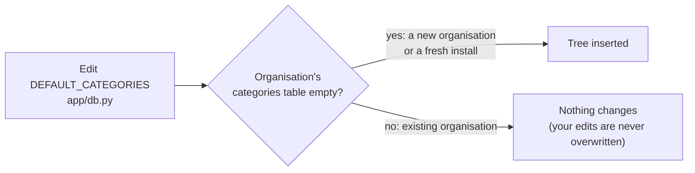

# Customizing

How to change what the app ships with: the **default categories** and a few other built-in lists. These are code changes for whoever maintains the repository. To change *your own* categories, just use the app's pages.

**Contents:** [Default categories](#default-categories) · [Other built-in lists](#other-built-in-lists) · [After any change](#after-any-change)

## Default categories

Every **new** organisation starts with a category tree. It's defined in one place: `DEFAULT_CATEGORIES` in [`app/db.py`](../app/db.py).

```python
# (name, kind, [children]) — a sensible starting tree; rename/move/delete freely in the app.
DEFAULT_CATEGORIES = [
    ("Food", "expense", ["Groceries", "Dining", "Coffee"]),
    ("Housing", "expense", ["Rent / Mortgage", "Utilities", "Maintenance", "Home Insurance"]),
    ...
    ("Income", "income", ["Salary", "Interest & Dividends", "Refunds", "Other Income"]),
    ("Transfers", "transfer", ["Credit Card Payment", "Between My Accounts", "Investment Contribution"]),
]
```



### To add, rename or remove a default category

1. Edit `DEFAULT_CATEGORIES` in `app/db.py`. Each entry is `(top-level name, kind, [child names])`.
   - **kind** is `"expense"`, `"income"` or `"transfer"`. Children get their parent's kind.
   - The defaults are **two levels**. Users can add a third level in the app; keep the defaults at two so there's room.
   - Names must be unique among siblings (case-insensitive).
   - Card payments and moves between accounts must stay under a `"transfer"` category, or they'll be counted as spending.
2. Check the names the code relies on (search for them before renaming):
   - Tests look categories up by name (`Food`, `Groceries`, `Coffee`, `Dining`, `Fuel`, `Household`, `Housing`, `Shopping`, `Travel`, `Utilities`, `Salary`, `Other Income`, `Other Expenses`…): `grep -rn 'cat_id("' tests/`.
   - `tools/make_demo.py` uses them for demo data.
3. Run the tests: `python -m pytest -q`.
4. Check it in a fresh data folder: `PFI_DATA_DIR=/tmp/cat-test python -m app` and open **Categories**.
5. Update the category list in [reference.md](reference.md#categories) if you mention specific names there.

### Existing organisations don't change

The default tree is only inserted when an organisation has **no categories at all**, so editing `DEFAULT_CATEGORIES` never touches anyone's existing tree. To give existing users a new category you have two options:
- **Tell them to add it** on the Categories page (simplest; it's their tree).
- **Add it in an upgrade step** in `db.init()`, guarded so it runs once and never duplicates or overrides their choices, e.g. insert *Pets* only if no top-level category called *Pets* exists. Add a test. Use this sparingly: users may have deliberately deleted a default.

## Other built-in lists

| What | Where | Notes |
|---|---|---|
| CSV column guesses | `_DATE_HINTS`, `_DESC_HINTS`, `_MEMO_HINTS`, `_AMOUNT_HINTS`, `_DEBIT_HINTS`, `_CREDIT_HINTS` in `app/importers/csv_import.py` | Lowercase header names, most specific first. Only affects the first guess; users can always change it. |
| Date formats tried | `DATE_FORMATS` in `app/normalize.py` | Order matters when a date is ambiguous (03/04/2026). Add a test with a sample. |
| Payee clean-up | `_PAYEE_NOISE` in `app/normalize.py` | Regexes removed from bank descriptions (card numbers, store numbers, POS/ACH words). Keep the last pattern (whitespace) last. Users can rename payees with rules. |
| Account types | `ACCOUNT_TYPES` in `app/main.py` **and** the `CHECK` on `accounts.type` in `db.SCHEMA` | Changing the CHECK needs a table rebuild: see [Changing the database](development.md#changing-the-database). |

## After any change

- [ ] `python -m pytest -q` passes.
- [ ] Tried it in a fresh data folder (`PFI_DATA_DIR=/tmp/something`).
- [ ] Docs that name specific categories updated.
- [ ] Nothing personal committed: no real cards held, transactions or names.
