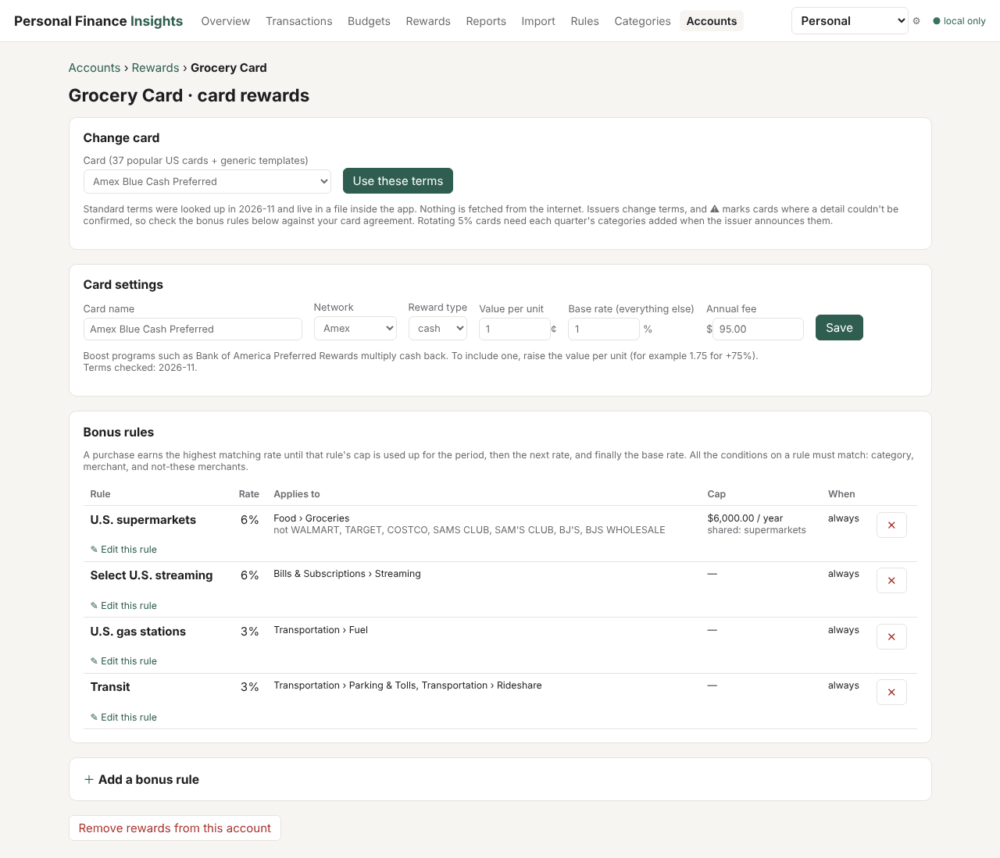
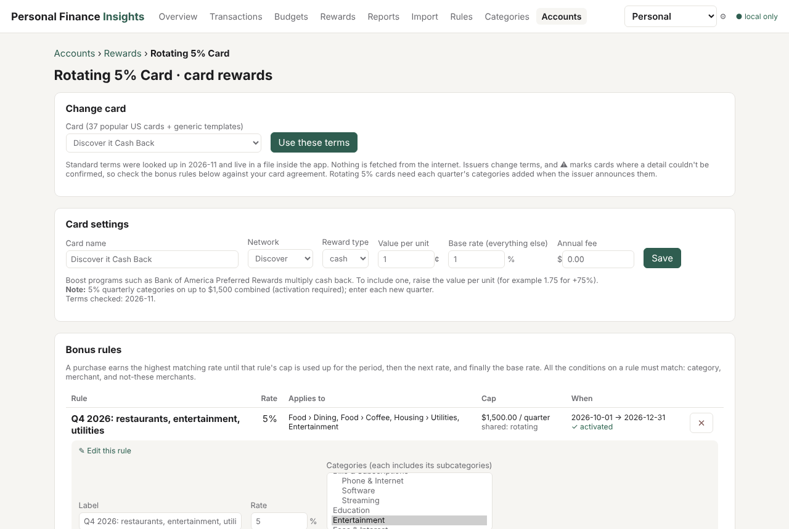
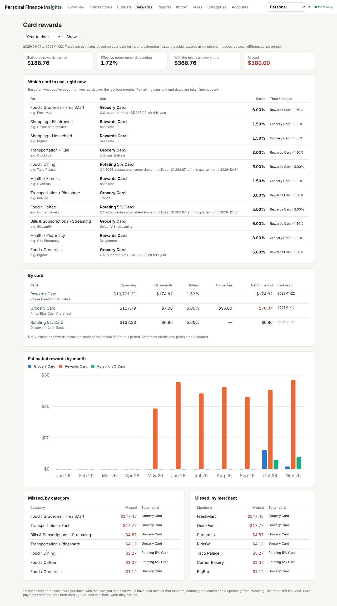
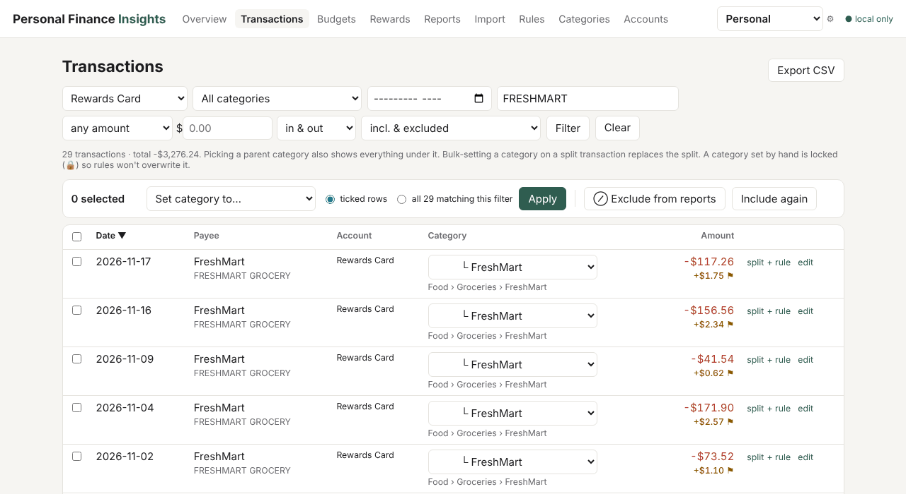

# Credit card rewards

**Contents:** [Setting up a card](#setting-up-a-card) · [How earnings are estimated](#how-earnings-are-estimated) · [The Rewards tab](#the-rewards-tab) · [Worked example](#worked-example) · [About accuracy](#about-accuracy) · [Card settings reference](#card-settings-reference)

Estimates what each credit card purchase earns, which card to use for what, and what you're missing. It works **entirely offline**: rewards are worked out from card terms plus your own transactions, and nothing is fetched or sent anywhere.

## Setting up a card
1. On **Accounts**, any account with type **credit** shows **💳 set up rewards**. You can also start from the **Rewards** tab.
2. Pick the card from the built-in list: **37 popular US cards** (Chase, Amex, Citi, Capital One, Wells Fargo, Bank of America, Discover, U.S. Bank, Apple, Robinhood, and airline and hotel cards) plus generic flat-rate templates. The account's name pre-selects the card when it can.
3. Check the **bonus rules** it fills in: rate, categories (each includes its subcategories), merchants, a cap per month, quarter or year, dates, and whether the bonus needs activation. Edit or add rules to match your card agreement.
4. In **Card settings**, set the **value per point** for points and miles cards (so 1.5¢ Delta miles and 1¢ cash back compare fairly), the network, the annual fee, and any boost. For example, Bank of America Preferred Rewards +75% is entered as a value of 1.75.

## How earnings are estimated
- A purchase earns the highest matching rate until that rule's cap is used up for the period, then the next rate, and finally the base rate. A purchase that crosses a cap is split at the cap. Rules with the same *shared cap name* share one cap, as with Bank of America's choice category plus groceries.
- **Refunds** take back what they earned. **Card payments and transfers** earn nothing. **Split** transactions earn per part. Transactions you've **⊘ excluded** from reports still earn, because exclusion is about budgeting, not about what the card pays you.
- **Rotating 5% cards** need each quarter's categories added, with dates, the $1,500 cap and "needs activation". The Rewards page reminds you when a quarter has none, when a bonus isn't activated, when a cap is nearly used, when a card hasn't been used for 5 months (issuers may close it), and when card terms are more than 6 months old.
- Cards are only suggested where they're accepted. For example, Costco US takes Visa only.

## The Rewards tab
- **Which card to use, right now:** for what you actually buy on your cards, the card that pays most today, taking remaining caps and end dates into account, plus the runner-up. The top five also appear on the **Overview**.
- **By card:** spending, estimated rewards, effective return %, annual fee, net value for the period, and last used date.
- **Missed rewards:** by category and by merchant, compared with the best card you hold for each purchase (that card's caps included). Spending from checking, such as rent, isn't counted as missed.

On **Transactions**, each card purchase shows its estimated reward, and **⚑** marks one where another of your cards would have earned more. Hover over it to see which card.

## About accuracy

 these are estimates. Issuers decide rewards using the merchant's code (MCC), which bank exports rarely include, so the app relies on your categories and on merchant names. Caps use calendar periods, while some issuers use billing cycles. The built-in card terms were checked in November 2026 and ⚠ marks cards with a detail that couldn't be confirmed. Always compare against your card agreement. The list lives in [`tools/build_card_catalog.py`](../tools/build_card_catalog.py) and contains public product terms only, never anyone's own cards. To add a card or update terms, follow [Customizing: card catalog](customizing.md#card-catalog-rewards).

## Worked example

A card earns 6% on groceries up to $6,000 a year, then 1%. By November you've spent $5,900 on groceries this year, and you buy $250 more:

| Part | Amount | Rate | Earns |
|---|---|---|---|
| Fills the rest of the cap | $100 | 6% | $6.00 |
| Past the cap | $150 | 1% (base) | $1.50 |
| **Total** | **$250** | **3.0% effective** | **$7.50** |

For a points card the same arithmetic gives points, then multiplies by the value per point: 3 points per $1 on $100 at 1.25¢ a point is 300 × 1.25¢ = $3.75.

## Card settings reference

| Setting | Meaning |
|---|---|
| Card name | Starts as the catalog card's name; rename freely. Choosing a different catalog card replaces all its bonus rules. |
| Reward type | cash, points or miles |
| Value per point / unit (¢) | What one unit is worth to you. 1.0 for cash back. Raise it for a boost such as Bank of America Preferred Rewards (+75% → 1.75). |
| Base rate (everything else) | Units per $1 when no bonus rule applies (1.5 = 1.5%) |
| Network | Visa, Mastercard, Amex, Discover or Other. Used to skip cards a store doesn't accept. |
| Annual fee | Subtracted in **net value** on the Rewards page |
| Terms checked | Shown under the form: when the catalog terms were last looked up. The Rewards page reminds you once they're more than 6 months old. |

**Bonus rule fields**

| Field | Meaning |
|---|---|
| Label | Shown on the card and in recommendations |
| Rate | Units per $1 for matching purchases |
| Categories | Matching categories, each including its subcategories |
| Merchants | Description contains any of these, separated by commas. If the rule also has categories, a purchase must match both. |
| …but not these | Description contains none of these, e.g. *grocery stores, not Walmart or Target* |
| Spending cap at this rate + period | Spend limit at this rate per calendar month, quarter or year. Leave empty for no cap. |
| Shared cap name | Rules with the same name share one cap |
| From / to | Dates the rule is active (inclusive), for rotating or limited-time bonuses |
| Needs activation / activated | Bonus counts only once marked activated |

How the calculation is built, for developers: [Architecture: rewards engine](architecture.md#rewards-engine).
