# User guide

A quick tour of every page. All screenshots use made-up demo data (see [Try it with demo data](#try-it-with-demo-data)). For every option in detail, see the [reference](reference.md); for card rewards, see [Credit card rewards](rewards.md).

**Contents:** [Getting started](#getting-started) · [Importing](#importing-statements) · [Transactions](#working-with-transactions) · [Splitting](#splitting-a-transaction) · [Rules](#rules) · [Categories](#categories) · [Budgets](#budgets) · [Reports](#reports) · [Card rewards](rewards.md) · [Leaving money out of reports](#leaving-money-out-of-reports) · [Organisations](#organisations) · [Troubleshooting](#troubleshooting)

## Getting started

1. **Accounts →** add each account you track (checking, savings, credit card, loan). Set its *opening balance* to the balance just before the first transaction you'll import. Enter money owed on cards and loans as a negative number.
2. **Import →** upload a statement for each account (see below).
3. **Transactions →** give uncategorised transactions a category. Use **+ rule** on any row so the next import does it for you.
4. **Budgets →** set monthly limits. **Overview** and **Reports** fill in by themselves.

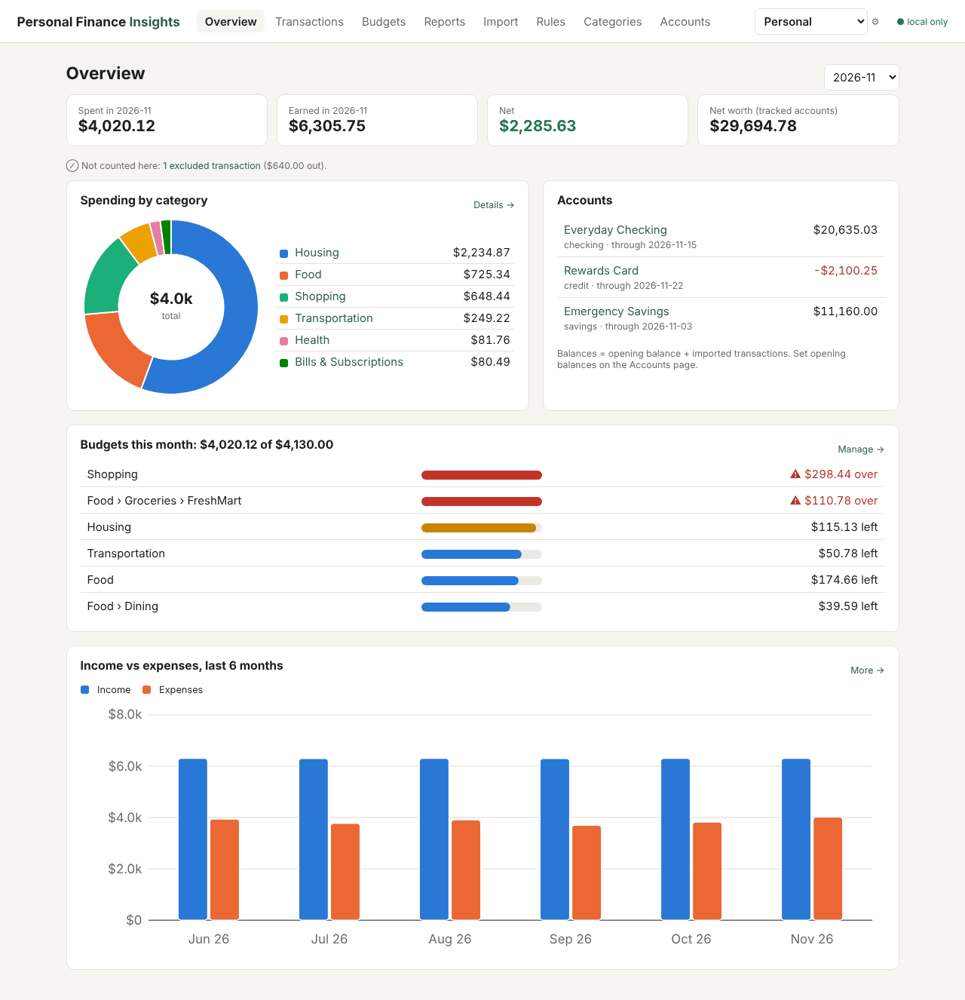

*Overview: this month's totals, spending by category, balances, the budgets closest to their limit, and the last six months.*

## Importing statements

- Download **OFX / QFX** ("Quicken" / "Web Connect") from your bank if it's offered: it imports with no setup.
- With **CSV**, the first file from each bank opens this mapping screen. Check the guessed columns and the preview, then import. Purchases must show red (negative). If they don't, tick **Flip sign**. The layout is remembered, so next time it's one click.
- Re-importing overlapping dates is safe, because duplicates are skipped. Every import can be **undone** from the import history.

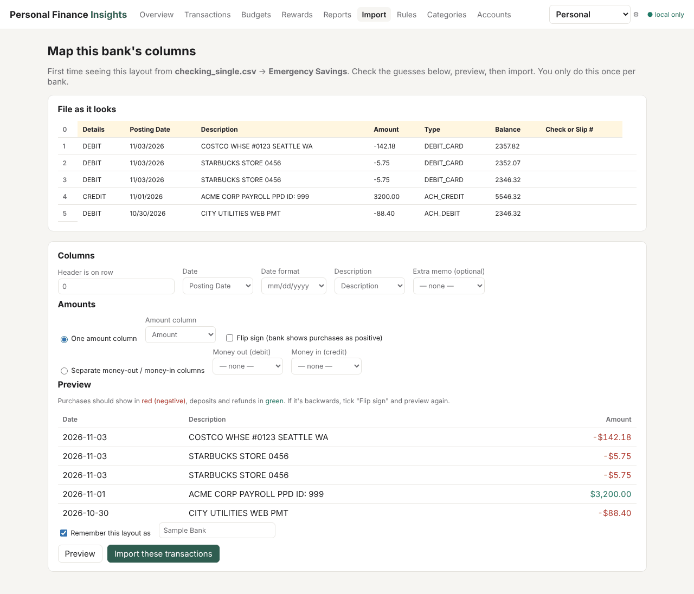

## Working with transactions

- **Filter** by account, category (a parent includes its subcategories), month, text, **amount** (equals / more than / at least / less than / at most / between, typed as positive numbers) and **money in or out**. Typing a number such as `24.85` in the search box finds that exact amount.
- **Sort** by clicking any column header; click again to reverse.
- **Bulk edit:** tick rows (the header box ticks the whole page) or choose *all matching this filter*, then set a category, or **⊘ Exclude from reports** / **Include again**.
- On each row: **split** · **+ rule** (make a rule from this payee) · **edit** (rename the payee, add a note, exclude from reports). 🔒 means the category was set by hand, so rules won't change it.
- **Export CSV** downloads exactly what the current filter shows.

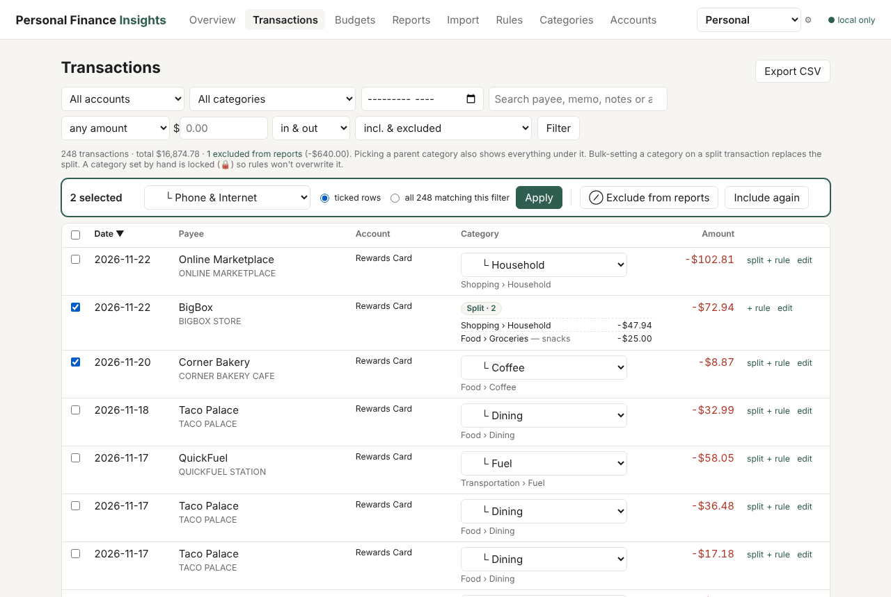

## Splitting a transaction

Click **split** to divide one charge across categories, for example a store trip that was mostly household items plus some groceries. Enter each part as a positive number. **Remaining** must reach $0.00, and *Put the remainder on the last filled line* does the arithmetic for you. Reports and budgets use the parts.

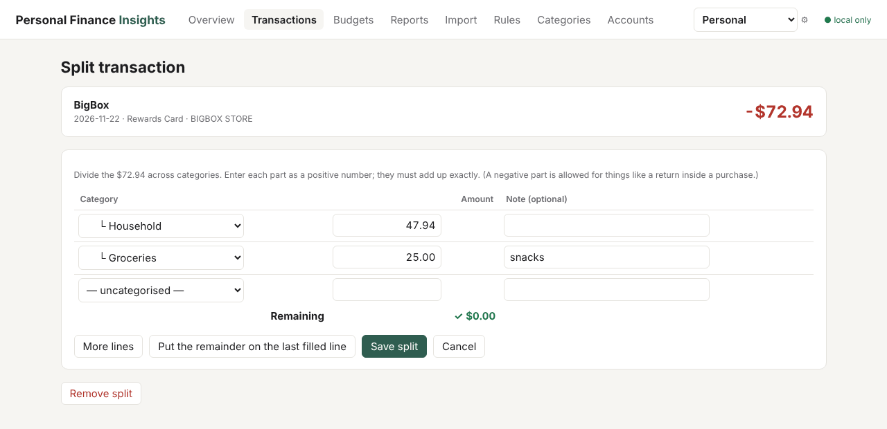

## Rules

A rule fires when **all** its conditions match:
- any number of text tests: contains, doesn't contain, starts with, equals, regex
- an amount: type a positive number and choose money out or in
- an account

It then sets a category, can rename the payee, and can exclude the transaction from reports.

- **The first matching rule wins.** Lower priority numbers run first. Put specific rules (e.g. *marketplace AND more than $150*) at a lower number than general ones (*marketplace*).
- **Matches** shows how many transactions each rule catches. *"+N taken by earlier rule"* means a higher-priority rule got there first: lower this rule's number.
- Saving a rule only touches **uncategorised** transactions unless you choose *re-apply to all*, or *…including hand-set 🔒*.

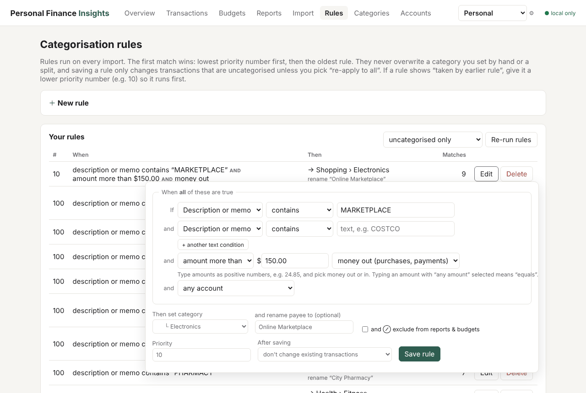

## Categories

Categories can be up to **3 levels** deep, for example Food › Groceries › FreshMart. On this page you can:
- add a category, rename it, or move it (with everything under it) to a new parent
- delete a category: its subcategories and transactions move up to its parent
- **⊘ exclude** a category (see [Leaving money out of reports](#leaving-money-out-of-reports))

Use a *transfer* kind for card payments and moves between your own accounts, so they're never counted as spending.

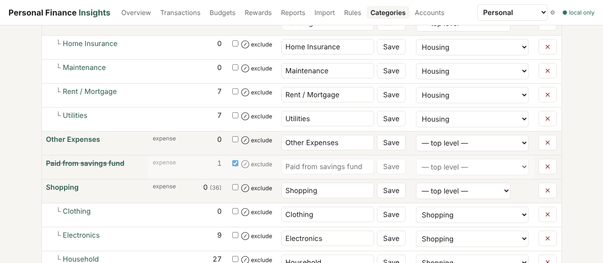

## Budgets

Type a monthly amount next to any category. Then choose to save it as your **usual monthly budget**, or **only for this month** (enter 0 to skip a category for one month). A parent's spending includes its subcategories, and totals never count a parent and its children twice. Bars turn amber at 90% and red with **⚠ over** past 100%.

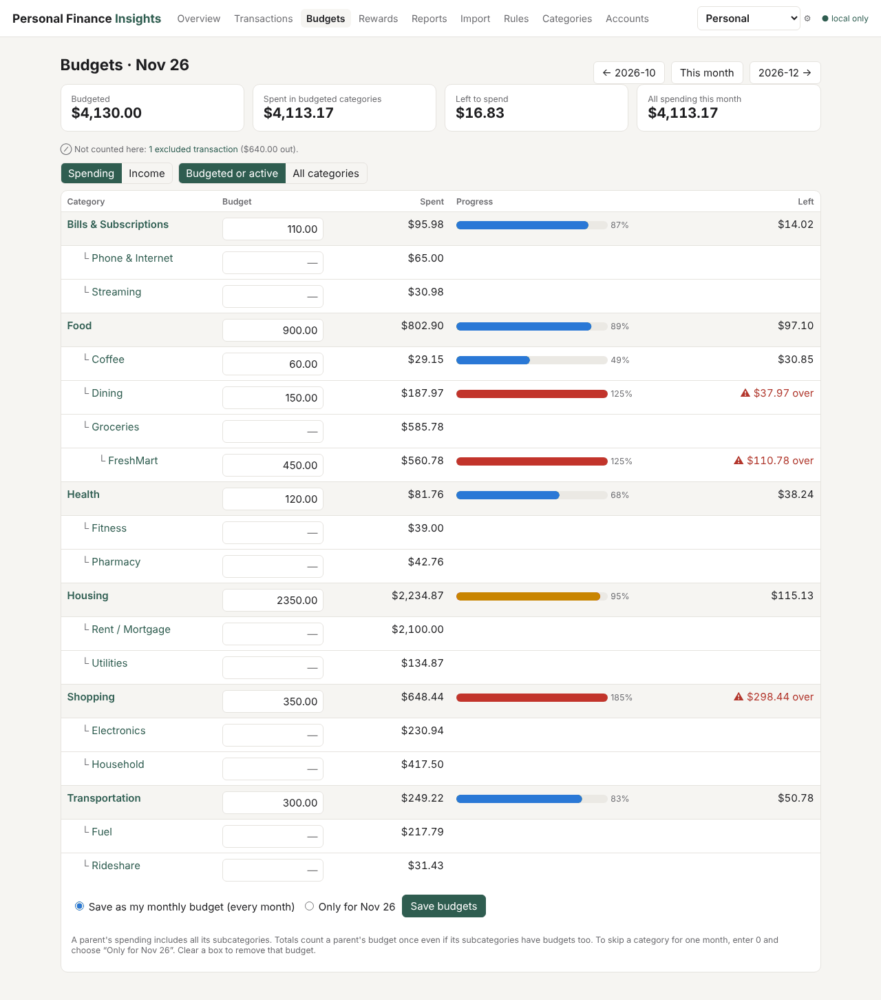

## Reports

Every report has a period picker (this month … all time, or custom dates), an account filter, and a table under the chart. Click any row to see its transactions. Hover over a bar or slice for the exact amount.

| Report | What it answers |
|---|---|
| **Spending / Income by category** | Where the money went. Choose **Pie or Bar**, how deep to break down (levels 1–3), or **Subcategories of** one category. |
| **Income vs expenses** | Monthly income, spending, net and savings rate. |
| **Spending over time** | Month-by-month for all spending or any one category. |
| **Merchants** | Who you pay most, as a pie or bar. Click a merchant for its trend and categories. |
| **Net worth** | Assets, debts and net worth at each month end. |

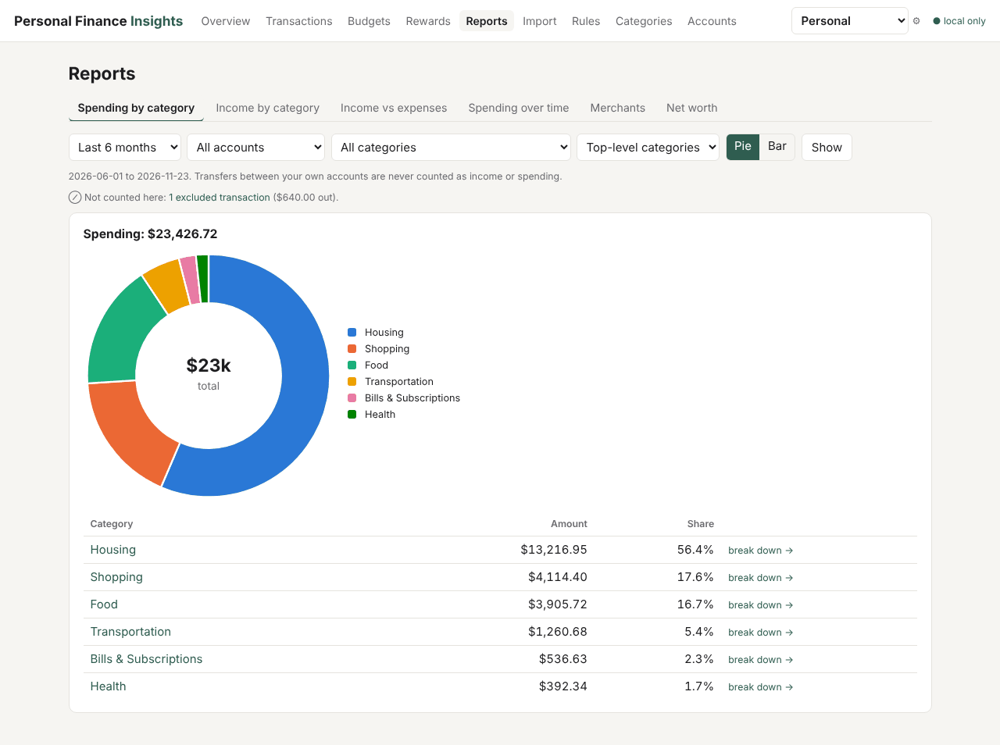

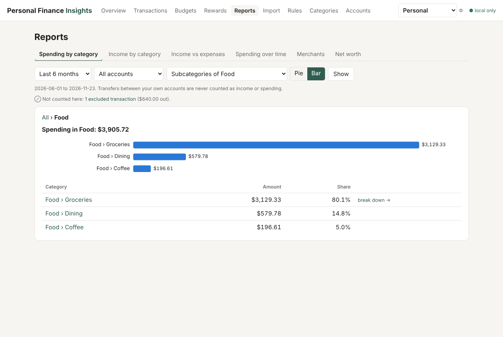

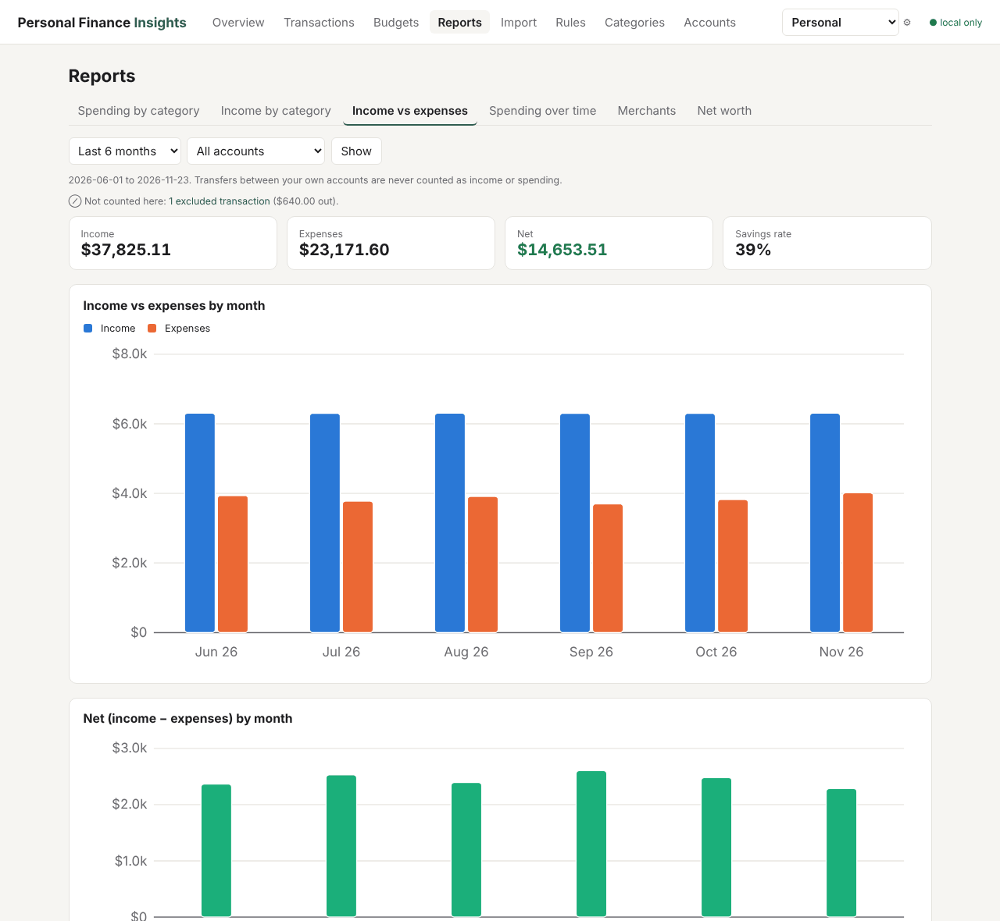

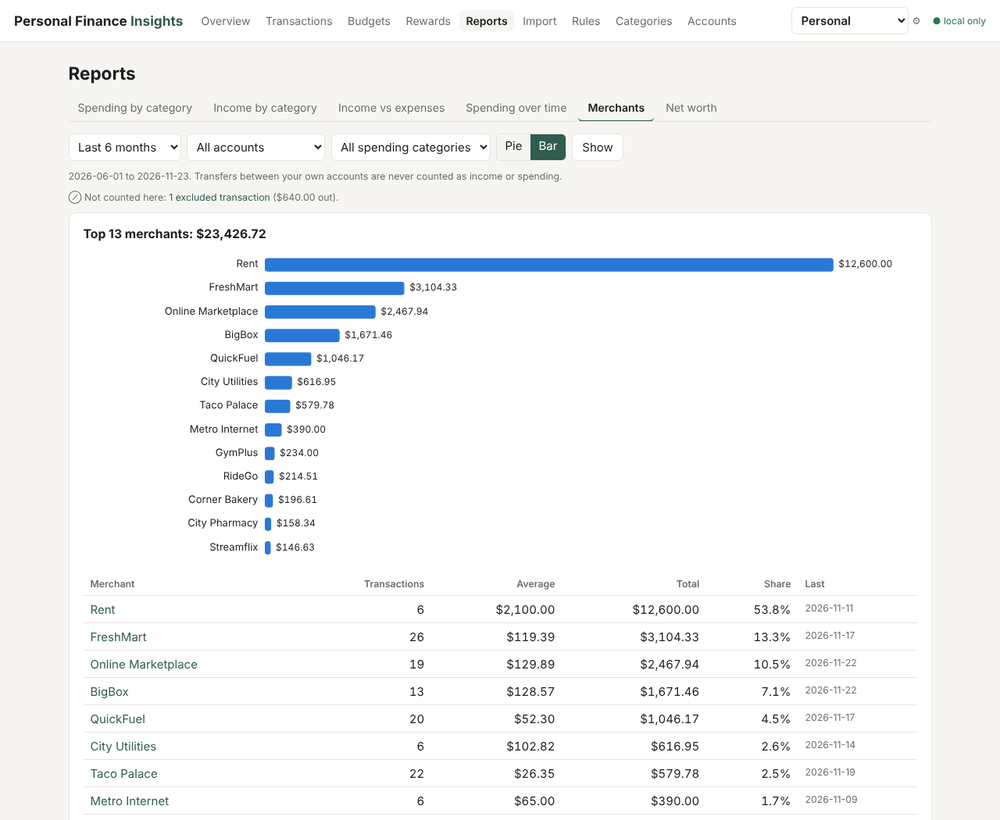

## Leaving money out of reports

Some money would be counted twice. Example: you already count $400 a month going into a savings fund. If you later pay a $640 car repair *from* that fund and count it too, the same money shows up twice. **⊘ Exclude** the repair, and it stays out of reports and budgets. You can exclude:
- one transaction: **edit** → *Leave out of reports & budgets*
- many at once: the bulk bar
- a whole category, e.g. *Paid from savings fund*: tick **⊘ exclude** on Categories
- automatically: a rule with *and ⊘ exclude from reports & budgets*

Excluded rows stay visible (dimmed, marked ⊘) and **still count in balances and net worth**. Every report says what was left out: *"⊘ Not counted here: 1 excluded transaction ($640.00 out)"*.

## Organisations

Use organisations to keep separate books, for example for another person, a rental property or a business. Each has its own accounts, categories, rules and budgets, in **its own database file**. Switch with the menu at the top right. **⚙** lets you create, rename or remove one; a removed organisation's file is moved to `data/deleted/`, not erased.

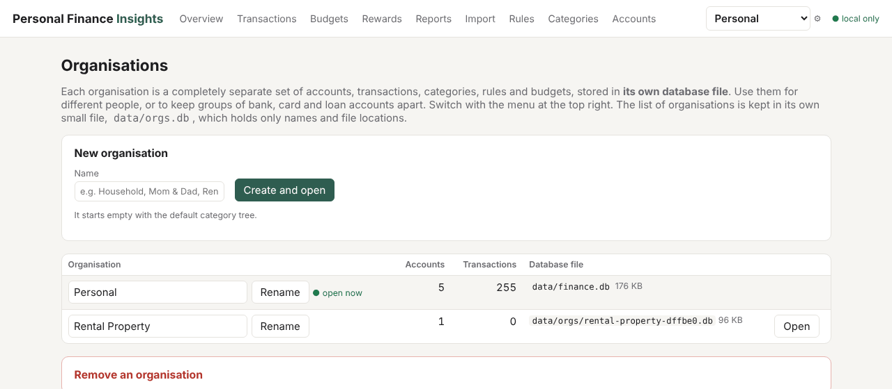

## Troubleshooting

| Problem | What to do |
|---|---|
| A rule doesn't change anything | Check **Matches**: *"taken by earlier rule"* means lower its priority number. Transactions with 🔒 (set by hand) or a split are skipped unless you re-apply *including hand-set*. |
| Totals don't match my bank statement | Card payments and transfers should use a *transfer* category, so they aren't counted as spending. Check for **⊘ excluded** transactions (each report shows them). For balances, check each account's **opening balance**. |
| CSV amounts are backwards | Delete that layout under *Import → Saved CSV layouts*, re-import, and tick **Flip sign**. |
| I imported the wrong file | *Import → history → Undo* removes everything that import added. |
| Page says *Cross-site request blocked* | Open the app at `http://127.0.0.1:8765` (not another address or a bookmark to an old port). |
| A card's rewards look wrong | Open the card from **Rewards → By card** and check its bonus rules: categories (anything shown as *needs a category* isn't mapped yet), the cap and period, dates, and whether the bonus is marked **activated**. Purchases need categories to match category bonuses. |
| Port 8765 is already in use | Windows: `set PFI_PORT=8766` then `run.bat`. macOS/Linux: `PFI_PORT=8766 sh run.sh`. |
| Starting fresh / moving computers | Stop the app and copy the whole `data` folder; it works across Windows, macOS and Linux. Run a backup (`backup.bat` or `sh backup.sh`) before any upgrade. |
| `run.sh` says Python is missing or too old (macOS/Linux) | Install Python 3.11+ as described in [Run it](install.md), or point to a newer one: `PYTHON=python3.12 sh run.sh`. |
| "Could not create the environment" (Linux) | Install the venv module: `sudo apt install python3-venv` on Debian/Ubuntu. |

## Try it with demo data

Start the app once first (so `.venv` exists), stop it, then:

**Windows**
```
.venv\Scripts\pip install -r requirements-dev.txt
.venv\Scripts\python tools\make_demo.py demo-data
set PFI_DATA_DIR=demo-data
run.bat
```

**macOS / Linux**
```sh
.venv/bin/pip install -r requirements-dev.txt
.venv/bin/python tools/make_demo.py demo-data
PFI_DATA_DIR=demo-data sh run.sh
```

This builds a separate folder of made-up accounts and transactions, plus three demo credit cards with rewards set up, which are the ones in these screenshots. To regenerate the screenshots, see the [development guide](development.md#demo-data-and-screenshots). Your real `data` folder isn't touched. Delete `demo-data` when you're done.

